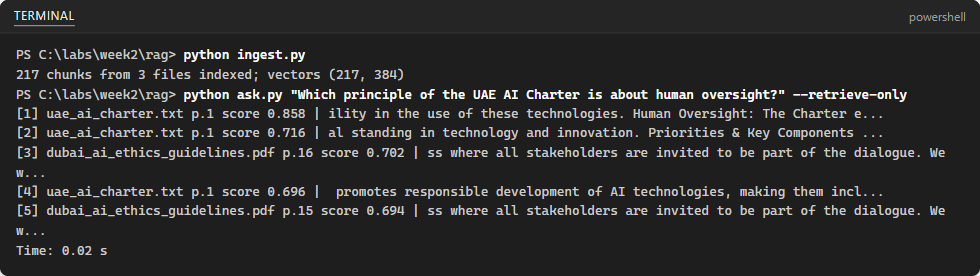
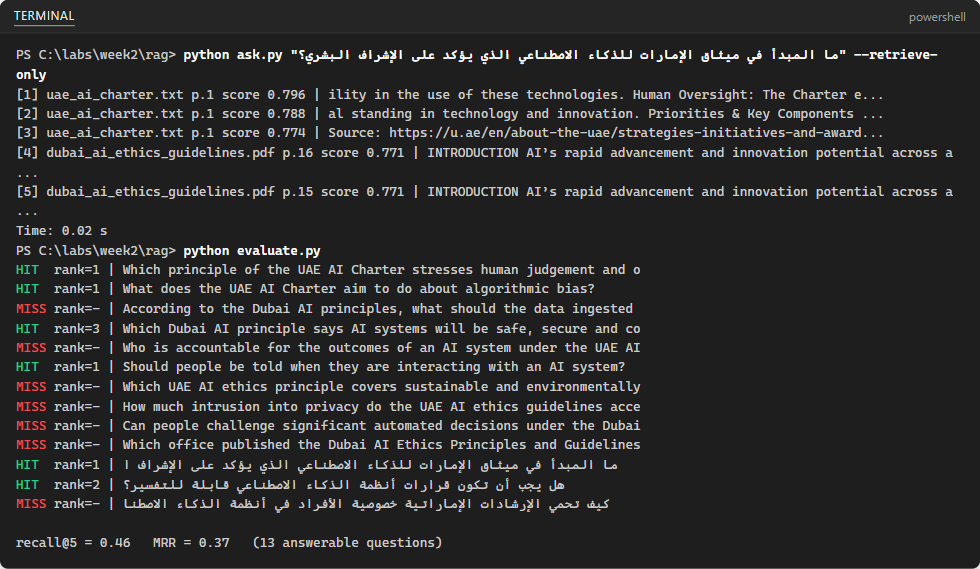

## What you will learn

### What we will do

Load public UAE policy documents, clean and chunk their text, embed the
chunks and retrieve evidence for English and Arabic questions. Optionally
generate cited answers with Gemini, then evaluate retrieval and improve
one pipeline choice at a time, including the later Part 2 exercise.

### Libraries and tools

Use `pypdf` for PDF extraction, `sentence-transformers` for local embeddings
and `numpy` for vector storage and search. `faiss-cpu` is optional.
`google-genai` and `python-dotenv` support the Gemini answer step.
Standard-library `unicodedata`, `re`, `json`, `csv` and `pathlib` handle
cleaning, files and evidence.

### Important calls and commands

`PdfReader` and `extract_text()` read PDFs; `unicodedata.normalize("NFKC", ...)`
and `re.sub()` clean text. `SentenceTransformer(MODEL).encode()` produces
embeddings. `vectors @ q` ranks normalized vectors by cosine similarity;
optional `faiss.IndexFlatIP` creates an index, `index.add()` stores vectors
and `index.search()` performs exhaustive inner-product retrieval.
The lab's `retrieve()`
function supplies evidence to the answer step and evaluation.

### Expected results

Create `chunks.json`, `vectors.npy`, top-ranked source/page passages and
`results.csv` with the lab's question-level hit rate labelled recall@5 and
top-five MRR. If Gemini access is available, inspect cited answers too.
Counts, scores and answers depend on your documents and configuration;
historical screenshots are examples, not required exact results.

### Connection to agentic AI

Retrieval can be an agent's evidence-gathering tool. Metadata, citations,
evaluation and declining unsupported questions help keep its responses
grounded. This fixed RAG pipeline is not itself an autonomous agent:
you are learning a component that an agent can later call.

[All student labs](../../../../README.md) |
[Prerequisite: Python setup](../00-Python-Lab-Setup-Python/README.md) |
[Prerequisite: 01-GAIS-Lab-JSON-Schema](../../02-Google-AI-Studio/01-GAIS-Lab-JSON-Schema/README.md) |
[Next: 02-GAIS-Lab-Embedding-File-Search](../../02-Google-AI-Studio/02-GAIS-Lab-Embedding-File-Search/README.md)

Complete the steps in your separate portfolio repository. This lab includes the
75-minute exercise and Part 2 in Week 2, Session 4. Retrieval and evaluation can
run without a Gemini key; answer generation uses the key from Google Lab 1.
Preserve document attribution and never commit secrets. Source testing notes
below are historical, not a new live-cloud validation.

This is the original Python Lab 1 in the Python category. Retrieval and
evaluation run locally without a cloud key. Optional answer generation uses
Gemini and requires the linked Google JSON Schema lab; it is not Python-only.
No AWS service or Bedrock Knowledge Base is created by this exercise.

## Lab Overview

| Field | Details |
| --- | --- |
| Lab type | Hands-on lab |
| Course slide | Slide 126 · Week 2, Session 2 · Wed 30 Sep 2026 (Part 2 in Week 2, Session 4) |
| Expected duration | 75 minutes, plus Part 2 in Week 2, Session 4 |
| Environment | Your laptop: Python, VS Code; the embedding model runs locally |
| Account and cost | Free: local embedding model; Gemini API free tier for the answers |
| Related labs | Skillable Lab 04 (RAG with Foundry); Google Lab 2; AWS Lab 2 |
| Public docs | [Sentence Transformers](https://sbert.net/) · [FAISS](https://github.com/facebookresearch/faiss) · [Gemini text generation](https://ai.google.dev/gemini-api/docs/text-generation) |
| Tested | 2026-10-09 · see the note at the end of the lab |

## Before you start

This lab runs on your own laptop or in Google Colab. Use Python 3.12, 3.13 or 3.14 with VS Code and the Python extension. Work inside your portfolio repository so that you can commit the evidence at the end.

Values that you type are shown like this: example.

* You need the Gemini API key from Google Lab 1 for the answers. Retrieval and evaluation work without any key.
* The first run downloads the multilingual embedding model (about 470 MB). Use a good connection.
* The documents are public and published under Creative Commons Attribution 4.0 (the two PDFs) or on the official UAE Government portal (the Charter). Keep the attribution in your README.

When you are ready, continue below to start the exercise.

## Cited RAG pipeline over public UAE policy documents

In this exercise, you build a retrieval-augmented generation (RAG) pipeline over public UAE AI policy documents: load, clean, chunk, embed and index them; retrieve the best passages for a question in English or Arabic; and answer with numbered citations. Then you measure retrieval quality with an evaluation set and improve it one change at a time.

This exercise takes approximately **75** minutes.

## Get the documents

1. In your repository create the folder `week2/rag` with a subfolder `data`.
2. Download the two PDFs into `data` with these file names:

   * [UAE AI Ethics Principles and Guidelines (Dec 2022)](https://assets.u.ae/api/public/content/893c940c21c4403ea8df7faad66a889e?v=b2f9c1a1) → `uae_ai_ethics_guidelines.pdf`
   * [Smart Dubai AI Ethics Principles and Guidelines](https://www.digitaldubai.ae/docs/default-source/ai-principles-resources/ai-ethics.pdf) → `dubai_ai_ethics_guidelines.pdf`

   ```powershell
   Invoke-WebRequest "https://assets.u.ae/api/public/content/893c940c21c4403ea8df7faad66a889e?v=b2f9c1a1" -OutFile data\uae_ai_ethics_guidelines.pdf
   Invoke-WebRequest "https://www.digitaldubai.ae/docs/default-source/ai-principles-resources/ai-ethics.pdf" -OutFile data\dubai_ai_ethics_guidelines.pdf
   ```
3. Open [The UAE Charter for the Development and Use of Artificial Intelligence](https://u.ae/en/about-the-uae/strategies-initiatives-and-awards/policies/Ai/The-UAE-Charter-for-the-Development-and-Use-of-Artificial-Intelligence) on the UAE Government portal. Select the page text from the title down to the end of the **Expected Outcomes** list, copy it, and save it as `data/uae_ai_charter.txt` (UTF-8). Add the page URL as the first line.

   > **Note**: The Charter is published as a web page, not a PDF. The ingest script reads `.pdf`, `.txt` and `.md` files; a text file counts as one page.

## Set up the project

1. Open a terminal in `week2/rag`, create the environment and install the packages:

   ```powershell
   python -m venv .venv
   .venv\Scripts\Activate.ps1
   pip install pypdf sentence-transformers faiss-cpu numpy google-genai python-dotenv
   ```

   If `faiss-cpu` does not install on your Python version, skip it: the NumPy search below is just as fast for a few thousand chunks.
2. Create `.env` and `.gitignore`:

   ```powershell
   Set-Content .env "GEMINI_API_KEY=<your key>"
   Set-Content .gitignore ".venv/`n.env"
   ```

## Load, clean, chunk, embed and index

1. Create `ingest.py`:

   ```python
   """Load, clean, chunk, embed and index every document in the data folder."""
   import json
   import re
   import unicodedata
   from pathlib import Path

   import numpy as np
   from pypdf import PdfReader
   from sentence_transformers import SentenceTransformer

   MODEL = "sentence-transformers/paraphrase-multilingual-MiniLM-L12-v2"
   CHUNK_SIZE = 800  # characters per chunk
   OVERLAP = 150  # characters shared by neighbouring chunks


   def chunk_text(text, size=CHUNK_SIZE, overlap=OVERLAP):
       chunks, start = [], 0
       while start < len(text):
           chunks.append(text[start:start + size])
           start += size - overlap
       return [c for c in chunks if c.strip()]


   def read_pages(path):
       """Yield (page number, text). A .txt or .md file counts as one page."""
       if path.suffix.lower() == ".pdf":
           for number, page in enumerate(PdfReader(path).pages, start=1):
               yield number, page.extract_text() or ""
       else:
           yield 1, path.read_text(encoding="utf-8")


   def main():
       records = []
       for path in sorted(Path("data").iterdir()):
           if path.suffix.lower() not in {".pdf", ".txt", ".md"}:
               continue
           for page_no, raw in read_pages(path):
               text = unicodedata.normalize("NFKC", raw)  # splits PDF ligatures (one glyph for "fi") into letters
               text = re.sub(r"\s+", " ", text).strip()
               for i, chunk in enumerate(chunk_text(text)):
                   records.append({"id": f"{path.stem}-p{page_no}-c{i}", "source": path.name,
                                   "page": page_no, "text": chunk})
       model = SentenceTransformer(MODEL)
       vectors = model.encode([r["text"] for r in records], normalize_embeddings=True,
                              show_progress_bar=True)
       np.save("vectors.npy", vectors.astype("float32"))
       Path("chunks.json").write_text(json.dumps(records, ensure_ascii=False, indent=1), encoding="utf-8")
       files = len({r["source"] for r in records})
       print(f"{len(records)} chunks from {files} files indexed; vectors {vectors.shape}")


   if __name__ == "__main__":
       main()
   ```

   NFKC means Unicode Normalization Form Compatibility Composition. It
   converts compatibility characters to a consistent representation, then
   combines equivalent character sequences where possible. For example, the
   single ligature character `fi` becomes the two letters `fi`, and full-width
   `Ａ` becomes `A`. This reduces formatting differences in extracted PDF text;
   it does not translate text or fix all extraction errors. Compatibility
   normalization can remove meaningful distinctions, so keep the original
   documents as your reference.

   Cosine similarity compares the directions of two embedding vectors:
   `cosine(a, b) = dot(a, b) / (length(a) * length(b))`. For nonzero vectors,
   values range from -1 to 1; larger values indicate closer directions.
   With text embeddings this is a useful signal of semantic similarity,
   not a probability or proof that a passage answers the question.
   `normalize_embeddings=True` gives vectors unit length, so the dot product
   calculates cosine similarity directly.

   `SentenceTransformer(MODEL)` loads the named pretrained text-embedding
   model, downloading it on the first use if it is not cached. Its `encode`
   method turns each text chunk into a numeric vector; in this model each
   vector has 384 dimensions. Retrieval encodes the question with the same
   model so question and document vectors can be compared. This model does
   not generate the final answer: Gemini performs that separate step.
   If you change the embedding model, re-encode both documents and questions.

   * Cleaning: `NFKC` normalization splits PDF ligatures (one glyph for "fi") into letters, and the regular expression collapses spaces and line breaks.
   * Chunking: 800 characters with 150 characters of overlap, so a sentence cut at a boundary appears in both chunks.
   * Metadata: every chunk keeps its source file and page, which is what makes citations possible.
   * `normalize_embeddings=True` makes cosine similarity equal to a simple dot product.
2. Run `python ingest.py`. The first run downloads the model; then you should see:

   

   217 chunks from 3 files, each a 384-dimension vector. You may also see download progress bars and a warning about an `HF_TOKEN`; you can ignore both.

## Retrieve and answer with citations

1. Create `ask.py`:

   ```python
   """Retrieve the best chunks for a question and answer it with citations."""
   import argparse
   import json
   import time

   import numpy as np
   from sentence_transformers import SentenceTransformer

   EMBED_MODEL = "sentence-transformers/paraphrase-multilingual-MiniLM-L12-v2"
   GEMINI_MODEL = "gemini-3.8-flash"

   with open("chunks.json", encoding="utf-8") as f:
       records = json.load(f)
   vectors = np.load("vectors.npy")
   embedder = SentenceTransformer(EMBED_MODEL)


   def retrieve(question, k=5):
       q = embedder.encode([question], normalize_embeddings=True)[0]
       scores = vectors @ q  # cosine similarity, because all vectors are normalized
       best = np.argsort(-scores)[:k]
       return [(records[i], float(scores[i])) for i in best]


   def build_prompt(question, hits):
       sources = "\n\n".join(f"[{n}] ({h['source']} p.{h['page']}) {h['text']}"
                             for n, (h, _) in enumerate(hits, start=1))
       return ("Answer the question using only the numbered sources. Cite the source numbers "
               "you used, like [1]. If the sources do not contain the answer, say that you do not know.\n\n"
               f"Sources:\n{sources}\n\nQuestion: {question}")


   def generate(prompt):
       from dotenv import load_dotenv
       from google import genai

       load_dotenv()
       client = genai.Client()  # reads GEMINI_API_KEY from the environment
       interaction = client.interactions.create(model=GEMINI_MODEL, input=prompt)
       return interaction.output_text


   if __name__ == "__main__":
       parser = argparse.ArgumentParser()
       parser.add_argument("question")
       parser.add_argument("--k", type=int, default=5)
       parser.add_argument("--retrieve-only", action="store_true",
                           help="show the retrieved chunks without calling Gemini")
       args = parser.parse_args()
       start = time.perf_counter()
       hits = retrieve(args.question, args.k)
       if not args.retrieve_only:
           print(generate(build_prompt(args.question, hits)), "\n")
       for n, (h, score) in enumerate(hits, start=1):
           print(f"[{n}] {h['source']} p.{h['page']} score {score:.3f} | {h['text'][:70]}...")
       print(f"Time: {time.perf_counter() - start:.2f} s")
   ```

   * `retrieve` embeds the question with the same model and returns the five closest chunks.
   * `build_prompt` numbers the chunks [1] to [5] and tells the model to cite them and to say when it does not know.
   * `--retrieve-only` shows the retrieved chunks without calling Gemini: always check retrieval first.
2. Check retrieval for an English and an Arabic question:

   ```powershell
   python ask.py "Which principle of the UAE AI Charter is about human oversight?" --retrieve-only
   python ask.py "ما المبدأ في ميثاق الإمارات للذكاء الاصطناعي الذي يؤكد على الإشراف البشري؟" --retrieve-only
   ```

   In both cases the top result should be the Charter chunk that contains **Human Oversight**. The Arabic question finds the English passage because the embedding model is multilingual.
3. Now generate an answer with citations:

   ```powershell
   python ask.py "Which principle of the UAE AI Charter is about human oversight?"
   ```

   Expected: a short answer that names the Human Oversight principle and cites [1], followed by the list of sources with file names and pages.
4. Optional: the same search with FAISS. Create `faiss_search.py` and run it; the scores match the NumPy search exactly.

   NumPy is a Python library for numerical arrays and mathematical operations.
   Here it stores the embedding matrix, loads `vectors.npy`, computes all
   query-to-chunk dot products and sorts the scores. This direct search is
   practical for a small document collection.

   FAISS (Facebook AI Similarity Search) is a library for searching dense
   vectors. An index stores vectors and returns the nearest matches to a
   query. `IndexFlatIP` in this example performs an exact, exhaustive
   inner-product search; with normalized vectors it ranks by cosine
   similarity, just like NumPy. Scores should agree within floating-point
   tolerance, although tied results may appear in a different order.
   FAISS also offers approximate indexes for larger collections, but this
   example does not use one.

   ```python
   """Optional: the same search with FAISS instead of a NumPy dot product."""
   import json

   import faiss
   import numpy as np
   from sentence_transformers import SentenceTransformer

   with open("chunks.json", encoding="utf-8") as f:
       records = json.load(f)
   vectors = np.load("vectors.npy")
   index = faiss.IndexFlatIP(vectors.shape[1])  # inner product = cosine for normalized vectors
   index.add(vectors)

   model = SentenceTransformer("sentence-transformers/paraphrase-multilingual-MiniLM-L12-v2")
   query = model.encode(["Which principle of the UAE AI Charter is about human oversight?"],
                        normalize_embeddings=True)
   scores, ids = index.search(query, 5)
   for score, i in zip(scores[0], ids[0]):
       print(f"{records[i]['source']} p.{records[i]['page']} score {score:.3f}")
   ```
5. Run the optional FAISS search from your `week2/rag` work folder, using
   the same virtual environment as `ingest.py`. First confirm that ingestion
   has created `chunks.json` and `vectors.npy`, then run:

   ```powershell
   python faiss_search.py
   python ask.py "Which principle of the UAE AI Charter is about human oversight?" --retrieve-only
   ```

   The FAISS script prints five lines with a document filename, page number
   and similarity score, ordered from highest score to lowest. Compare these
   with the NumPy retrieval output for the same question. The top result
   should point to the Charter's Human Oversight evidence; use the passage
   text printed by `ask.py` to check this, rather than trusting the score alone.
   Source/page results and scores should agree within floating-point
   tolerance; equally scored chunks may appear in a different order.
   Neither command calls Gemini, and FAISS prints retrieval results, not a
   generated answer or latency.

   If Python reports `No module named 'faiss'`, check that you are using the
   RAG environment and that `faiss-cpu` was installed during setup. If that
   package is unavailable for your Python version, skip this optional step
   and retain the NumPy search.

## Measure retrieval with an evaluation set

Before you tune anything, write questions with known answers and the page that contains each answer (the gold page). Every later change is judged against this set.

1. Create `eval.csv`. It has 13 answerable questions (three in Arabic) and two questions the documents cannot answer. `gold_page` can list several pages separated by `;`:

   ```csv
   question,expected_answer,gold_source,gold_page
   Which principle of the UAE AI Charter stresses human judgement and oversight over AI?,Human Oversight,uae_ai_charter.txt,1
   What does the UAE AI Charter aim to do about algorithmic bias?,Address algorithmic bias so that AI is fair and equitable for all community members,uae_ai_charter.txt,1
   "According to the Dubai AI principles, what should the data ingested by AI systems be?",Representative of the affected population,dubai_ai_ethics_guidelines.pdf,8;21
   "Which Dubai AI principle says AI systems will be safe, secure and controllable by humans?",Security,dubai_ai_ethics_guidelines.pdf,10
   Who is accountable for the outcomes of an AI system under the UAE AI ethics guidelines?,"Not the AI system itself; the organisations that develop and operate it",uae_ai_ethics_guidelines.pdf,11
   Should people be told when they are interacting with an AI system?,Yes - people should be informed of the extent of their interaction with AI systems,uae_ai_ethics_guidelines.pdf,15
   Which UAE AI ethics principle covers sustainable and environmentally friendly AI?,Principle 7 - Sustainable and Environmentally Friendly AI,uae_ai_ethics_guidelines.pdf,20
   How much intrusion into privacy do the UAE AI ethics guidelines accept?,The minimum intrusion necessary,uae_ai_ethics_guidelines.pdf,21
   Can people challenge significant automated decisions under the Dubai guidelines?,"Yes, and where appropriate opt out of such decisions",dubai_ai_ethics_guidelines.pdf,26;8
   Which office published the Dubai AI Ethics Principles and Guidelines?,Smart Dubai Office,dubai_ai_ethics_guidelines.pdf,4;5
   ما المبدأ في ميثاق الإمارات للذكاء الاصطناعي الذي يؤكد على الإشراف البشري؟,Human Oversight,uae_ai_charter.txt,1
   هل يجب أن تكون قرارات أنظمة الذكاء الاصطناعي قابلة للتفسير؟,Yes - as explainable as technically possible,dubai_ai_ethics_guidelines.pdf,9;30
   كيف تحمي الإرشادات الإماراتية خصوصية الأفراد في أنظمة الذكاء الاصطناعي؟,Respect privacy and use the minimum intrusion necessary,uae_ai_ethics_guidelines.pdf,21;22
   What is the fine for breaking the UAE AI Charter?,Not in the documents - the system should say it does not know,,
   How many AI start-ups opened in Dubai in 2025?,Not in the documents - the system should say it does not know,,
   ```
2. Create `evaluate.py`. It counts a hit when a gold page is in the top five (recall@5) and rewards hits near the top (MRR):

   Recall describes how much relevant information a search retrieves.
   Standard recall@k is the number of relevant items in the top `k` divided
   by the total number of relevant items for that question. This lab's code
   uses a simpler question-level hit rate, labelled `recall@5`: a question
   counts as a hit if at least one of its accepted gold pages appears in the
   first five results. It does not require retrieving every accepted page.
   The reported value is `questions with a hit / answerable questions`.
   For example, 6 hits among 13 answerable questions gives about `0.46`.

   MRR means Mean Reciprocal Rank. For each answerable question, find the
   rank of the first matching source/page: rank 1 contributes `1`, rank 2
   contributes `1/2`, and rank 5 contributes `1/5`. A miss in the top five
   contributes `0`. Add these contributions and divide by the number of
   answerable questions. This lab therefore reports MRR truncated at five:
   it rewards correct evidence appearing near the top of the retrieved list.

   | Parameter or field | Role in this evaluation |
   | --- | --- |
   | `K = 5` | Retrieve the five highest-scoring chunks for each question |
   | `question` | Text passed to the retrieval model |
   | `expected_answer` | Reference for manually checking generated answers; the retrieval script does not score it |
   | `gold_source` | Expected document filename; an empty value marks an unanswerable question |
   | `gold_page` | Accepted page numbers, separated by `;`; both source and page must match |
   | `ranks` | One-based positions of matching source/page results |
   | `found` | Number of answerable questions with at least one match |
   | `reciprocal` | Sum of reciprocal first-match ranks |
   | `CONFIG` | Labels describing chunk size/overlap, embedding model and search method; update them when changing the pipeline |
   | `results.csv` | Records date, configuration labels, `K`, hit rate and MRR for each run |

   Both reported metrics range from 0 to 1; higher is better for this fixed
   evaluation set. They measure retrieval, not answer correctness or citation
   faithfulness. The two unanswerable questions are excluded from their
   denominators; separately check whether generated answers decline them.
   `SentenceTransformer(MODEL)` supplies the embeddings used by retrieval;
   `evaluate.py` imports `retrieve` from `ask.py` and does not train a model.

   ```python
   """Measure retrieval quality on eval.csv: recall@k and mean reciprocal rank (MRR)."""
   import csv
   import datetime

   from ask import retrieve

   K = 5
   CONFIG = {"chunking": "800/150", "embedding": "paraphrase-multilingual-MiniLM-L12-v2", "search": "numpy-cosine"}

   with open("eval.csv", encoding="utf-8") as f:
       rows = list(csv.DictReader(f))
   answerable = [r for r in rows if r["gold_source"]]

   found, reciprocal = 0, 0.0
   for r in answerable:
       hits = retrieve(r["question"], K)
       gold_pages = r["gold_page"].split(";")  # a passage can appear on more than one page
       ranks = [n for n, (h, _) in enumerate(hits, start=1)
                if h["source"] == r["gold_source"] and str(h["page"]) in gold_pages]
       if ranks:
           found += 1
           reciprocal += 1 / ranks[0]
       print(f"{'HIT ' if ranks else 'MISS'} rank={ranks[0] if ranks else '-'} | {r['question'][:68]}")

   recall = found / len(answerable)
   mrr = reciprocal / len(answerable)
   print(f"\nrecall@{K} = {recall:.2f}   MRR = {mrr:.2f}   ({len(answerable)} answerable questions)")

   with open("results.csv", "a", newline="", encoding="utf-8") as f:
       csv.writer(f).writerow([datetime.datetime.now().astimezone().date().isoformat(), *CONFIG.values(), K,
                               f"{recall:.2f}", f"{mrr:.2f}"])
   ```
3. Run `python evaluate.py`:

   

   A first run often scores low. Ours scored **recall@5 = 0.46** and **MRR = 0.37**. Look at the misses with `--retrieve-only`: short title pages and introduction pages that appear twice in the Dubai PDF crowd out the real passages.

## Improve one setting at a time

1. Add a cleaning step to `ingest.py` just before `model = SentenceTransformer(MODEL)` to drop duplicate and very short chunks, then run `python ingest.py` and `python evaluate.py` again:

   ```python
       seen, unique = set(), []
       for r in records:  # drop duplicate and very short chunks
           key = r["text"].strip().lower()
           if len(key) >= 200 and key not in seen:
               seen.add(key)
               unique.append(r)
       records = unique
   ```
2. Then try a retrieval-trained embedding model. Change `MODEL` in `ingest.py` and `EMBED_MODEL` in `ask.py` to `intfloat/multilingual-e5-small`, and add the prefixes this model expects: `"passage: " + r["text"]` when you embed chunks and `"query: " + question` when you embed the question. Re-run both scripts.

   > **Note**: Questions and documents must always be embedded with the same model. Re-index after every model change.
3. Compare your runs. Our results on 2026-10-09:

   | Run | Change | Chunks | recall@5 | MRR |
   | --- | --- | --- | --- | --- |
   | 1 | Baseline (800/150, MiniLM) | 217 | 0.46 | 0.37 |
   | 2 | Chunks of 500/100 instead | 333 | 0.46 | 0.37 |
   | 3 | Baseline + drop duplicate and short chunks | 180 | 0.54 | 0.39 |
   | 4 | Run 3 + multilingual-e5-small with prefixes | 180 | 0.62 | 0.46 |

   Each run appends a line to `results.csv`. Change only one thing per run, and keep the table: it tells the story of your engineering decisions.

## Part 2 (Week 2, Session 4): tests with GitHub Copilot

1. Ask GitHub Copilot to write pytest tests for `chunk_text` (chunks overlap by the overlap value, no chunk is empty) and for `retrieve` (returns k results sorted by score, using a small in-memory set so the test needs no PDFs).
2. Review every test before you keep it, run `pytest`, fix failures, and note in the README what you changed in Copilot's suggestions.

## Troubleshooting

* Empty text from a PDF page: the page is an image (scanned). Choose a text-based PDF or skip the page.
* Arabic looks reversed or broken in the terminal: that is a display issue; open `chunks.json` in VS Code to check.
* `429` from Gemini: wait a minute; retrieval and evaluation do not call Gemini.
* A very slow first run: the model is downloading; later runs use the cache.

## Summary

You built a cited RAG pipeline that works in Arabic and English, measured retrieval with recall@5 and MRR, and improved it with evidence instead of guesses.

## Clean up

Nothing is billable. Commit `ingest.py`, `ask.py`, `evaluate.py`, `eval.csv`, `results.csv` and a README with your run table and three example answers with citations. Do not commit `.env`, `.venv` or the model cache. Committing the public documents with attribution is fine.

### End the lab

Keep `chunks.json`: Azure Lab 2 packages it into a container.

### How this lab was tested

On 2026-10-09 all scripts were run on Windows 11 with Python 3.14 (sentence-transformers 6.1, FAISS 1.15, pypdf 6.19) against the documents downloaded from the links above; the screenshots and the run table are from those runs. The Gemini answer step was checked with an invalid key only.
