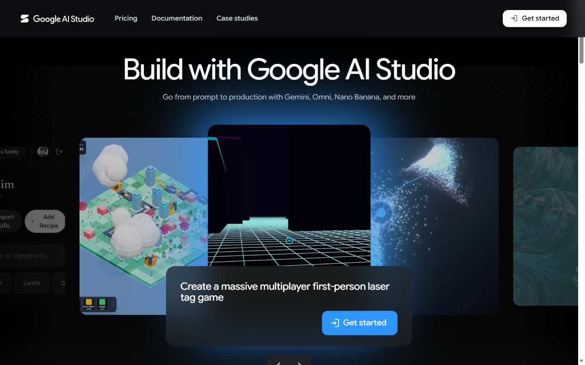

## Start here

[All student labs](../../../../README.md) |
[00-Setup-Lab](../../00-Setup-Lab/README.md) |
[Next: 01-GAIS-Lab-JSON-Schema](../01-GAIS-Lab-JSON-Schema/README.md)

This setup adapts the general setup lab's local readiness, separate work
repository, conditional access and evidence safeguards specifically for Google
AI Studio. It uses the Gemini Developer API, not Vertex AI or the Google Cloud
Free Trial. A Google Cloud trial credit balance does not fund AI Studio calls.

## Prerequisites and access gate

1. Complete the offline tools and GitHub checks in 00-Setup-Lab.
2. Use one personal Google account for the course. Verify current age and regional
   eligibility in the [available regions documentation](https://ai.google.dev/gemini-api/docs/available-regions).
3. Open websites in standalone Microsoft Edge. Complete account selection,
   consent and any MFA yourself in the browser.
4. Check current [Gemini pricing](https://ai.google.dev/gemini-api/docs/pricing)
   and [rate limits](https://ai.google.dev/gemini-api/docs/rate-limits).
   Free-tier availability is model- and account-dependent, not a promise of
   unlimited calls.
5. If access is unavailable, stop and record pending or offline. Do not bypass
   regional restrictions or activate paid billing to complete setup.

## Open AI Studio and create or verify your key

1. Open [Google AI Studio](https://aistudio.google.com), select Get started and
   sign in to your personal account.
2. Review applicable terms privately before accepting them. Use only public,
   synthetic or non-sensitive data; free-tier content may be used to improve
   Google products.
3. Open [API keys](https://aistudio.google.com/apikey). Reuse your course project
   and existing key when suitable, or create a key using the page instructions.
4. Keep the key private. Never put it in code, GitHub issues, screenshots,
   recordings, terminal output or chat. If exposed, revoke it on the API keys
   page and replace it.
5. Check the selected project's free-tier and model availability. Do not enable
   paid billing, auto-reload or a separate Google Cloud trial for this exercise.



## Prepare your separate work repository

1. In your own work/submission repository, create `week1/gemini`. Do not add
   credentials or completed work to the course materials clone.
2. Apply the [.gitignore rules from 00-Setup-Lab](../../00-Setup-Lab/.gitignore)
   to your work repository. Ensure `.env`, `.env.*`, `.venv/`, private keys and
   credential files remain ignored.
3. Create an isolated environment without activating it:

   ```powershell
   Set-Location week1\gemini
   uv venv .venv --python 3.13
   .\.venv\Scripts\python.exe --version
   ```

   If `uv` is unavailable, use `py -3.13 -m venv .venv` instead.
   On macOS/Linux use `.venv/bin/python` to inspect the interpreter.
4. In VS Code, select this interpreter. Create `.env` with the placeholder
   `GEMINI_API_KEY=<your key>`, then privately replace the placeholder in the
   editor. Do not enter your real key in a terminal command.
5. Verify the file is ignored without displaying its contents:

   ```powershell
   git check-ignore .env
   git status --short
   ```

   `git check-ignore` should print `.env`; status must not list that file.
   If it does, stop and correct ignore rules before committing.

No packages or model calls are required in setup. Install the packages and make
your first request in 01-GAIS-Lab-JSON-Schema.

## Acceptance and evidence

Record a sanitized checklist in your work repository:

| Check | Required evidence |
| --- | --- |
| Offline readiness | Successful local setup check |
| Separate work repository | URL and collaborator invitation state |
| AI Studio eligibility | Eligible, pending or offline |
| Tier and models | Reviewed, without project/account identifiers |
| Key safety | `.env` ignored; no secret values shown |
| Environment | Interpreter version and selected environment |

You can complete offline readiness without cloud access. Do not present an
offline check as a successful Gemini request.

## Troubleshooting and cleanup

* Missing Python: reopen your terminal and check the launcher version.
* Unsupported account or region: record the blocker and consult the trainer.
* Key exposed: revoke it before proceeding and remediate the exposure.
* `.env` shown by Git: fix ignore rules; never commit it.

No hosted resources or paid upgrades are needed. Sign out of AI Studio when
finished. Keep your course key private for the coding labs; revoke it when the
course no longer requires it. Do not delete shared accounts or projects.

## Official sources and validation limits

This checklist is adapted from the course setup and Google Lab 1 instructions.
It is not evidence of a newly executed authentication or live API test.

* [Gemini API keys](https://ai.google.dev/gemini-api/docs/api-key)
* [Gemini models](https://ai.google.dev/gemini-api/docs/models)
* [Google Cloud trial exclusions](https://docs.cloud.google.com/free/docs/free-cloud-features)
