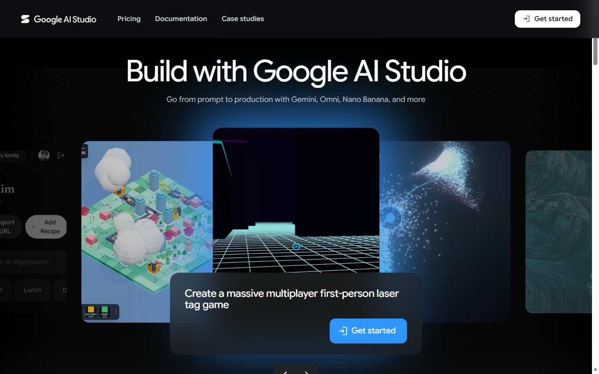

## What you will learn

### What we will do

Call Gemini from Python, compare zero-shot, few-shot, reasoning and Arabic
prompts, then classify synthetic hotel reviews into a validated JSON contract.
Record correctness, response variability and latency.

### Libraries and tools

Use `google-genai` for requests, `pydantic` for the response contract and
`python-dotenv` for local key loading. Standard-library `csv` records results
and `time` measures latency and spaces requests.

### Important calls and commands

`load_dotenv()` loads local configuration; `genai.Client()` creates the SDK
client; `client.interactions.create()` submits a prompt.
`Review.model_json_schema()` describes the required output shape,
`Review.model_validate_json()` validates a response and `model_dump()`
exposes parsed fields. `time.perf_counter()` measures elapsed time.

### Expected results

Produce a first answer with latency, repeated prompt observations and
`model_comparison.csv`. Review output reports `valid` or `INVALID` and the
first-try validation count. Check sentiment and follow-up values manually:
schema validity alone does not prove correctness, and live results can vary.

### Connection to agentic AI

Structured outputs become reliable inputs to later workflow steps and agent
tools. Validation prevents malformed data from silently driving an action.
This lab practices those building blocks, not an autonomous decision loop.

[All student labs](../../../../README.md) |
[Google Gemini setup](../00-GAIS-Lab-Setup-Google-Gemini/README.md) |
[Prerequisite: Challenge 0](../../00-Setup-Lab/README.md) |
[Next: AWS Lab 1](../../03-AWS/01-AWS-Lab-bedrock/README.md)

Complete the steps in your separate portfolio repository. Check current provider
pricing, model availability and eligibility before using your own account.
Never commit your API key. Source testing notes below are historical, not a new
live-cloud validation.

Complete Google Gemini setup first. Reuse its course key, work folder and
environment; verify the setup steps below rather than creating a second key
or overwriting an existing comparison table.

## Lab Overview

| Field | Details |
| --- | --- |
| Lab type | Hands-on lab |
| Course slide | Slide 90 · Week 1, Session 3 · Sat 26 Sep 2026 |
| Expected duration | 45 to 60 minutes |
| Environment | Your laptop: Python, VS Code; Google AI Studio in a web browser |
| Account and cost | Gemini API free tier (no payment method) |
| Related labs | Skillable Lab 01 and Lab 03 (same prompts in Foundry); AWS Lab 1 (same prompts in Bedrock) |
| Public docs | [Structured outputs](https://ai.google.dev/gemini-api/docs/structured-output) · [API keys](https://ai.google.dev/gemini-api/docs/api-key) |
| Tested | 2026-10-09 · see the note at the end of the lab |

## Before you start

You need one personal Google account (Gmail) for all four Google labs. You must be 18 or older. The United Arab Emirates is a supported country for Google AI Studio and the Gemini API ([available regions](https://ai.google.dev/gemini-api/docs/available-regions)). Turn off any VPN.

* The Gemini API free tier needs **no payment method**. Rate limits apply per project; you can see them in Google AI Studio.
* Content you send on the free tier may be used to improve Google products. Use only public, synthetic or non-sensitive data, never personal data.
* Keep your API key in a `.env` file that is listed in `.gitignore`. Never paste a key into code, chats, screenshots or commits.

Values that you type or select are shown like this: example. Replace anything in angle brackets, such as `<your key>`, with your own value.

When you are ready, continue below to start the exercise.

## Call Gemini from Python with a JSON response schema

In this exercise, you create a free Gemini API key in Google AI Studio, call the Gemini API from Python, run the Week 1 prompts, and ask for JSON output that follows a response schema. You add the results to the Week 1 model comparison table, next to Microsoft Foundry (Skillable Labs 01 and 03) and Amazon Bedrock (AWS Lab 1).

This exercise takes approximately **45** minutes.

## Prerequisites

Before starting this exercise, ensure you have:

* A personal Google account (18 or older)
* [Visual Studio Code](https://code.visualstudio.com/) with the Python extension
* Python 3.12, 3.13 or 3.14 and Git
* Your portfolio repository cloned on your laptop

## Create a Gemini API key

Google AI Studio is Google's web tool for trying Gemini models and managing API keys.

1. In a web browser, open [Google AI Studio](https://aistudio.google.com) at `https://aistudio.google.com` and select **Get started**. Sign in with your personal Google account.

   
2. If you are asked to, accept the Google APIs Terms of Service and the Gemini API Additional Terms. New users get a default Google Cloud project and an API key automatically.
3. Open <https://aistudio.google.com/apikey> at `https://aistudio.google.com/apikey`. If no key is listed, select **Create API key** and follow the dialog to create a key in a new or existing project. Copy the key.

   > **Note**: Keys created in AI Studio only work with the Gemini API, but they still identify you. Treat the key like a password: if it is ever exposed, delete it on this page and create a new one.
4. Read how free usage works before you continue.

   * The Gemini API **free tier** is free usage within rate limits (requests per minute, tokens per minute and requests per day). It is not a credit balance and needs no card.
   * The [Google Cloud Free Trial](https://cloud.google.com/free) (USD 300 for 90 days, card for verification) is for Google Cloud services such as BigQuery. It cannot be used for the Gemini API in AI Studio, and you do not need it for this lab.

## Set up the project

1. In VS Code, open your portfolio repository and create the folder `week1/gemini`. Right-click the folder and select **Open in Integrated Terminal**.
2. Create and activate a virtual environment, then install the packages:

   ```powershell
   python -m venv .venv
   .venv\Scripts\Activate.ps1
   pip install -U google-genai pydantic python-dotenv
   ```

   On macOS or Linux use `source .venv/bin/activate` instead of the second line.
3. Create the files that keep your key out of Git and start the comparison table:

   ```powershell
   Set-Content .gitignore ".venv/`n.env"
   Set-Content .env "GEMINI_API_KEY=<your key>"
   Set-Content model_comparison.csv "provider,model,prompt_id,correct,latency_s,valid_json,notes"
   ```

   Open `.env` in VS Code and replace `<your key>` with the key you copied. The Google Gen AI SDK reads `GEMINI_API_KEY` automatically.

## Make your first call

1. Create a file named `hello.py` with the following code:

   ```python
   import time

   from dotenv import load_dotenv
   from google import genai

   load_dotenv()  # reads GEMINI_API_KEY from the .env file
   client = genai.Client()

   start = time.perf_counter()
   interaction = client.interactions.create(
       model="gemini-3.8-flash",
       input="Explain in two sentences what an AI engineer does.",
   )
   print(interaction.output_text)
   print(f"Latency: {time.perf_counter() - start:.2f} s")
   ```
2. Run it:

   ```powershell
   python hello.py
   ```

   You should see a two-sentence answer and a latency figure, for example `Latency: 1.84 s`.

   > **Note**: The current Gemini documentation uses the **Interactions API** (`client.interactions.create`) shown here. Older tutorials use `client.models.generate_content`; both work with the same key.

## Run the Week 1 prompts

Use the same prompts as in the Foundry chat lab so that the comparison is fair.

1. Create `run_prompts.py`. It runs a zero-shot, a few-shot, a reasoning and an Arabic prompt three times each and appends every answer to `model_comparison.csv`:

   ```python
   """Run the Week 1 prompts three times each and log answers and latency."""
   import csv
   import time

   from dotenv import load_dotenv
   from google import genai

   MODEL = "gemini-3.8-flash"
   RUNS = 3

   PROMPTS = {
       "zero-shot": (
           "Classify this hotel review as positive, neutral or negative. Reply with one word.\n"
           "Review: The room was clean but the Wi-Fi kept dropping all evening."
       ),
       "few-shot": (
           "Classify each hotel review as positive, neutral or negative. Reply with one word.\n"
           "Review: Friendly staff and a great view of the Creek. Label: positive\n"
           "Review: The pool was closed and nobody told us. Label: negative\n"
           "Review: Average breakfast, convenient location. Label: neutral\n"
           "Review: Check-in was quick but the room smelled of smoke. Label:"
       ),
       "reasoning": (
           "Read the hotel review. First list the evidence for each possible label "
           "(positive, neutral, negative). Then give the final answer on the last line as 'Label: <label>'.\n"
           "Review: Beautiful lobby, but we waited 40 minutes for our room and the AC was noisy."
       ),
       "arabic": (
           "Classify this hotel review as positive, neutral or negative. Reply with one word.\n"
           "Review: الموقع ممتاز والغرفة واسعة، لكن الإفطار كان بارداً."
       ),
   }

   load_dotenv()
   client = genai.Client()
   with open("model_comparison.csv", "a", newline="", encoding="utf-8") as f:
       log = csv.writer(f)
       for prompt_id, prompt in PROMPTS.items():
           for run in range(1, RUNS + 1):
               start = time.perf_counter()
               interaction = client.interactions.create(model=MODEL, input=prompt)
               latency = time.perf_counter() - start
               answer = interaction.output_text.strip().replace("\n", " ")
               print(f"{prompt_id:<10} run {run}  {latency:5.2f}s  {answer[:80]}")
               # columns: provider, model, prompt_id, correct, latency_s, valid_json, notes
               log.writerow(["gemini", MODEL, prompt_id, "", f"{latency:.2f}", "", f"run {run}: {answer[:60]}"])
               time.sleep(2)  # stay well inside the free-tier rate limits
   ```
2. Run `python run_prompts.py`. It takes about a minute because it pauses between calls to stay inside the free-tier limits.

   For each prompt, decide whether the answer is correct and whether it changed between the three runs. Open `model_comparison.csv` and type yes or no in the `correct` column.

## Ask for JSON with a response schema

A response schema makes the model return JSON in an exact shape. You still validate it in code, because a valid shape can still contain wrong values.

1. Create `review_json.py`:

   ```python
   """Ask Gemini for JSON that follows a schema, validate it with Pydantic and log the result."""
   import csv
   import time
   from typing import Literal

   from dotenv import load_dotenv
   from google import genai
   from pydantic import BaseModel, Field, ValidationError

   MODEL = "gemini-3.8-flash"


   class Review(BaseModel):
       sentiment: Literal["positive", "neutral", "negative"]
       topics: list[str] = Field(description="Aspects mentioned, for example staff, cleanliness, location, price")
       language: Literal["ar", "en"]
       needs_follow_up: bool = Field(description="True if the guest reports a problem the hotel should act on")


   REVIEWS = [
       "The room was spotless but check-in took 40 minutes and nobody apologised.",
       "Great location next to the metro, friendly staff and a lovely breakfast.",
       "الغرفة نظيفة جداً والموظفون متعاونون، والإفطار ممتاز.",
       "انتظرنا ساعة كاملة لتسجيل الدخول، والمكيف لا يعمل.",
   ]

   load_dotenv()
   client = genai.Client()
   valid = 0
   with open("model_comparison.csv", "a", newline="", encoding="utf-8") as f:
       log = csv.writer(f)
       for number, text in enumerate(REVIEWS, start=1):
           start = time.perf_counter()
           interaction = client.interactions.create(
               model=MODEL,
               input=f"Analyze this hotel review: {text}",
               response_format={"type": "text", "mime_type": "application/json",
                                "schema": Review.model_json_schema()},
           )
           latency = time.perf_counter() - start
           try:
               review = Review.model_validate_json(interaction.output_text)
               valid += 1
               ok = "yes"
               print(f"{number}. valid   {latency:.2f}s  {review.model_dump()}")
           except ValidationError as err:
               ok = "no"
               print(f"{number}. INVALID {latency:.2f}s  {err.errors()[0]['msg']}")
           log.writerow(["gemini", MODEL, f"json-{number}", "", f"{latency:.2f}", ok, ""])
           time.sleep(2)
   print(f"Valid JSON on the first try: {valid}/{len(REVIEWS)}")
   ```

   * The Pydantic class `Review` is the contract. `Review.model_json_schema()` turns it into the JSON schema sent to Gemini.
   * `response_format` asks for `application/json` that follows that schema.
   * `Review.model_validate_json` checks the answer; a failure is printed instead of crashing.
2. In the terminal in `week1/gemini`, run the exact command:

   ```powershell
   python review_json.py
   ```

   Allow about a minute, depending on API latency. The script pauses between
   calls to reduce request frequency; your project's free-tier rate limits
   still apply.
3. Check the output. Each line shows `valid` or `INVALID`, the latency and the parsed fields. The last line counts how many answers were valid on the first try.

   Check the values, not only the format: is `needs_follow_up` true for the two complaints? Is `language` correct for the Arabic reviews?
4. Add at least six more synthetic reviews to the `REVIEWS` list (three of them in Arabic, one that mixes Arabic and English) and run the script again. Record the number of valid answers.

## Troubleshooting

* `400 API key not valid`: the key in `.env` is wrong, has spaces or was deleted. Copy it again from the API keys page.
* `429 RESOURCE_EXHAUSTED`: you hit a free-tier rate limit. Wait a minute and run again.
* `404 ... model not found`: model names change. Check [the model list](https://ai.google.dev/gemini-api/docs/models) and update `MODEL`.
* `User location is not supported`: turn off your VPN or use another network.
* `ModuleNotFoundError`: the virtual environment is not active; run the activation line again.

## Summary

In this exercise, you created a free Gemini API key, called Gemini from Python, compared answers to the Week 1 prompts across three runs, and enforced a JSON contract with a response schema and Pydantic validation.

## Clean up

Nothing in this lab is billable. Keep your key for Google Labs 2 and 3. Before you commit, run `git status` and check that `.env` and `.venv` are not listed. Commit `hello.py`, `run_prompts.py`, `review_json.py`, `model_comparison.csv` and a short README with your observations.

### End the lab

Close the terminal. You will add Bedrock rows to the same comparison table in AWS Lab 1.

### How this lab was tested

On 2026-10-09 the code was run on Windows 11 with Python 3.14 and google-genai 2.26.0. Without a personal key, every request shape in this lab (plain prompt, JSON schema) was sent with a deliberately invalid key: the SDK accepted the parameters and the service answered `API key not valid`, which confirms the calls are well formed.
