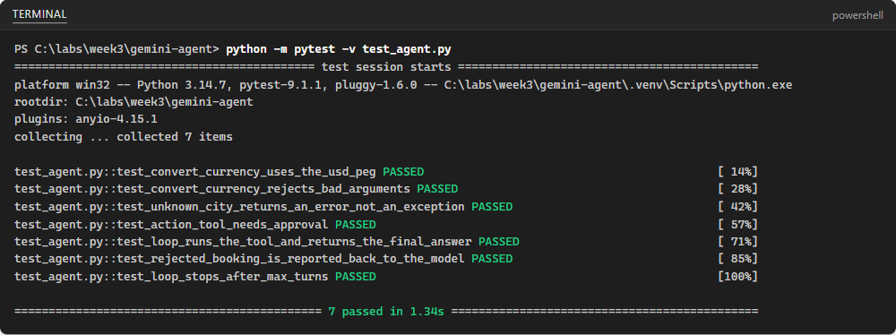

## What you will learn

### What we will do

Declare two read-only tools (`get_weather` and `convert_currency`) and one
consequential action tool (`book_tour`) with JSON schemas, write an explicit
Python tool-calling loop with a human approval gate and turn limit, test the
tools and loop offline with a fake client and `pytest`, then run the agent with
Gemini and compare the loop against the Microsoft Agent Framework from Lab 10.

### Libraries and tools

Use `google-genai` for Gemini interactions and tool declarations,
`python-dotenv` for local API-key loading and `pytest` for offline unit tests.
Standard-library `json` and `types.SimpleNamespace` serialize tool results and
simulate model responses offline.

### Important calls and commands

`client.interactions.create(..., tools=TOOLS)` sends a prompt or tool results
with JSON-schema function declarations. Filtering `interaction.steps` for
`step.type == "function_call"` detects requested tool invocations. `run_tool()`
validates tool names, checks `ACTION_TOOLS` with an `approve` callback and
catches `TypeError` on unexpected arguments. Passing `previous_interaction_id`
and `function_result` items continues the multi-turn agent loop up to
`max_turns`. `python -m pytest -v` verifies all seven offline tests before live
calls.

### Expected results

All seven offline `pytest` tests pass without network access or an API key.
Interactive runs produce `transcript.md` showing single, parallel and
sequential tool calls, one approved booking, one rejected booking that clearly
states no booking was made, and a polite explanation of a validation error,
plus `comparison.md` contrasting your loop with the Agent Framework.

### Connection to agentic AI

This lab implements the core control loop of a tool-using agent: the model
proposes tool calls, your application validates arguments, enforces human
approval on consequential actions, executes the functions and returns
structured results until the model answers or hits `max_turns`.

[All student labs](../../../../README.md) |
[Prerequisite: Google Lab 1](../01-GAIS-Lab-JSON-Schema/README.md) |
[Prerequisite: Google Lab 2](../02-GAIS-Lab-Embedding-File-Search/README.md) |
[Next: Google Lab 4](../04-GAIS-Lab-BigQuery-ML/README.md)

Complete the steps in your separate portfolio repository. Reuse your course
Gemini API key from Google Lab 1. Check current provider pricing, rate limits
and eligibility before making live requests. Never commit `.env` or your API
key. Source testing notes below are historical, not a new live-cloud validation.

## Lab Overview

| Field | Details |
| --- | --- |
| Lab type | Hands-on lab |
| Course slide | Slide 232 · Week 3, Session 3 · Wed 14 Oct 2026 |
| Expected duration | 45 to 60 minutes |
| Environment | Your laptop: Python, VS Code |
| Account and cost | Gemini API free tier |
| Related labs | Skillable Lab 07 (custom function), Lab 08 (MCP tools), Lab 10 (Agent Framework agent) |
| Public docs | [Function calling](https://ai.google.dev/gemini-api/docs/function-calling) |
| Tested | 2026-10-09 · see the note at the end of the lab |

## Before you start

You need one personal Google account (Gmail) for all four Google labs. You must be 18 or older. The United Arab Emirates is a supported country for Google AI Studio and the Gemini API ([available regions](https://ai.google.dev/gemini-api/docs/available-regions)). Turn off any VPN.

* The Gemini API free tier needs **no payment method**. Rate limits apply per project; you can see them in Google AI Studio.
* Content you send on the free tier may be used to improve Google products. Use only public, synthetic or non-sensitive data, never personal data.
* Keep your API key in a `.env` file that is listed in `.gitignore`. Never paste a key into code, chats, screenshots or commits.

Values that you type or select are shown like this: example. Replace anything in angle brackets, such as `<your key>`, with your own value.

When you are ready, continue below to start the exercise.

## Gemini function calling with a two-tool agent loop

In this exercise, you build a small agent with Gemini function calling. It has two read-only tools (weather and currency conversion) and one action tool (booking a desert safari) that needs your approval. Your code runs the tools; the model only asks for them. You test the tools and the approval gate offline, run the agent, and compare it with the Agent Framework agent from Lab 10.

This exercise takes approximately **45** minutes.

## Set up

1. Create `week3/gemini-agent` in your repository, open a terminal in it and prepare the environment:

   ```powershell
   python -m venv .venv
   .venv\Scripts\Activate.ps1
   pip install -U google-genai python-dotenv pytest
   Set-Content .env "GEMINI_API_KEY=<your key>"
   Set-Content .gitignore ".venv/`n.env"
   ```

## Write the tools and the agent loop

1. Create `agent.py`:

   ```python
   """A minimal Gemini agent: two read-only tools, one action tool that needs approval, and a loop."""
   import json

   from dotenv import load_dotenv
   from google import genai

   # MODEL = "gemini-3.8-flash"
   MODEL = "gemini-3.1-flash-lite"

   # Fixed demo data, so results are repeatable and no other API key is needed.
   WEATHER = {"dubai": {"temp_c": 31, "condition": "sunny"},
              "abu dhabi": {"temp_c": 32, "condition": "hazy"},
              "london": {"temp_c": 12, "condition": "rain"}}
   RATES = {"AED": 1.0, "USD": 3.6725, "EUR": 4.00, "GBP": 4.65}  # AED per 1 unit of currency


   def get_weather(city: str) -> dict:
       return WEATHER.get(city.strip().lower(), {"error": f"no weather data for {city}"})


   def convert_currency(amount: float, from_currency: str, to_currency: str) -> dict:
       source, target = from_currency.upper(), to_currency.upper()
       if source not in RATES or target not in RATES:
           return {"error": "unsupported currency"}
       if not 0 < amount <= 1_000_000:  # never trust model-generated arguments
           return {"error": "amount must be greater than 0 and at most 1,000,000"}
       return {"amount": round(amount * RATES[source] / RATES[target], 2), "currency": target}


   def book_tour(city: str, date: str, people: int) -> dict:
       return {"status": "booked", "reference": "DEMO-1042", "city": city, "date": date, "people": people}


   IMPLEMENTATIONS = {"get_weather": get_weather, "convert_currency": convert_currency, "book_tour": book_tour}
   ACTION_TOOLS = {"book_tour"}  # consequential tools that need human approval

   CURRENCIES = ["AED", "USD", "EUR", "GBP"]
   TOOLS = [
       {"type": "function", "name": "get_weather", "description": "Get today's weather for a city.",
        "parameters": {"type": "object", "required": ["city"],
                       "properties": {"city": {"type": "string", "description": "City name, for example Dubai"}}}},
       {"type": "function", "name": "convert_currency",
        "description": "Convert an amount of money between AED, USD, EUR and GBP.",
        "parameters": {"type": "object", "required": ["amount", "from_currency", "to_currency"],
                       "properties": {"amount": {"type": "number"},
                                      "from_currency": {"type": "string", "enum": CURRENCIES},
                                      "to_currency": {"type": "string", "enum": CURRENCIES}}}},
       {"type": "function", "name": "book_tour",
        "description": "Book a desert safari. This is a real action and needs the user's approval.",
        "parameters": {"type": "object", "required": ["city", "date", "people"],
                       "properties": {"city": {"type": "string"},
                                      "date": {"type": "string", "description": "YYYY-MM-DD"},
                                      "people": {"type": "integer"}}}},
   ]


   def ask_user(name, args):
       return input(f"Approve {name} {args}? (y/n) ").strip().lower() == "y"


   def run_tool(name, args, approve):
       if name not in IMPLEMENTATIONS:
           return {"error": f"unknown tool {name}"}
       if name in ACTION_TOOLS and not approve(name, args):
           return {"status": "rejected by the user"}
       try:
           return IMPLEMENTATIONS[name](**args)
       except TypeError as err:  # the model sent an unexpected argument
           return {"error": str(err)}


   def run(question, client, approve=ask_user, max_turns=5):
       interaction = client.interactions.create(model=MODEL, input=question, tools=TOOLS)
       for _ in range(max_turns):
           calls = [step for step in interaction.steps if step.type == "function_call"]
           if not calls:
               return interaction.output_text
           results = []
           for call in calls:
               args = call.arguments if isinstance(call.arguments, dict) else json.loads(call.arguments or "{}")
               result = run_tool(call.name, args, approve)
               print(f"[tool] {call.name}({args}) -> {result}")
               results.append({"type": "function_result", "name": call.name, "call_id": call.id,
                               "result": [{"type": "text", "text": json.dumps(result)}]})
           interaction = client.interactions.create(model=MODEL, input=results, tools=TOOLS,
                                                    previous_interaction_id=interaction.id)
       return "Stopped after too many tool turns."


   if __name__ == "__main__":
       load_dotenv()
       gemini = genai.Client()
       while True:
           question = input("\nQuestion (press Enter to quit): ").strip()
           if not question:
               break
           print("Agent:", run(question, gemini))
   ```

2. Read the code before you run it:

   * The tools are ordinary Python functions with fixed demo data, so results are repeatable and no other API key is needed. Only the USD peg (3.6725 AED) is a real rate.
   * `convert_currency` validates its arguments: never trust arguments generated by a model.
   * `TOOLS` declares each tool with a name, a description and a JSON schema. The model reads the descriptions to choose a tool, so write them carefully.
   * `run` is the loop: when the model returns `function_call` steps, your code runs the tools and sends `function_result` items back with the same `call_id`, linked by `previous_interaction_id`. `max_turns` stops runaway loops.
   * `book_tour` is in `ACTION_TOOLS`, so `run_tool` asks you to approve it first. A rejection is sent back to the model as a result, so it can tell the user.

## Test the tools and the approval gate offline

Good agents are tested without the model: the tests below replace Gemini with a fake client that returns prepared function calls.

1. Create `test_agent.py`:

   ```python
   """Offline tests: the tools, the approval gate and the loop, with a fake client instead of Gemini."""
   from types import SimpleNamespace as NS

   import agent


   class FakeInteractions:
       def __init__(self, replies):
           self.replies, self.calls = list(replies), []

       def create(self, **kwargs):
           self.calls.append(kwargs)
           return self.replies.pop(0)


   def fake_client(*replies):
       return NS(interactions=FakeInteractions(replies))


   def test_convert_currency_uses_the_usd_peg():
       assert agent.convert_currency(250, "USD", "AED") == {"amount": 918.12, "currency": "AED"}


   def test_convert_currency_rejects_bad_arguments():
       assert "error" in agent.convert_currency(-50, "EUR", "AED")
       assert "error" in agent.convert_currency(10, "XYZ", "AED")


   def test_unknown_city_returns_an_error_not_an_exception():
       assert "error" in agent.get_weather("Atlantis")


   def test_action_tool_needs_approval():
       args = {"city": "Dubai", "date": "2026-11-20", "people": 2}
       assert agent.run_tool("book_tour", args, approve=lambda n, a: False) == {"status": "rejected by the user"}
       assert agent.run_tool("book_tour", args, approve=lambda n, a: True)["status"] == "booked"


   def test_loop_runs_the_tool_and_returns_the_final_answer():
       first = NS(id="i1", output_text="",
                  steps=[NS(type="function_call", name="get_weather", arguments={"city": "Dubai"}, id="c1")])
       final = NS(id="i2", output_text="It is 31 C and sunny in Dubai.", steps=[NS(type="model_output")])
       client = fake_client(first, final)
       assert agent.run("Weather in Dubai?", client) == "It is 31 C and sunny in Dubai."
       second_call = client.interactions.calls[1]
       assert second_call["previous_interaction_id"] == "i1"
       assert second_call["input"][0]["call_id"] == "c1"


   def test_rejected_booking_is_reported_back_to_the_model():
       first = NS(id="i1", output_text="", steps=[NS(type="function_call", name="book_tour", id="c9",
                                                     arguments={"city": "Dubai", "date": "2026-11-20", "people": 2})])
       final = NS(id="i2", output_text="The booking was not made.", steps=[])
       client = fake_client(first, final)
       agent.run("Book a safari", client, approve=lambda n, a: False)
       assert "rejected" in client.interactions.calls[1]["input"][0]["result"][0]["text"]


   def test_loop_stops_after_max_turns():
       looping = NS(id="i", output_text="",
                    steps=[NS(type="function_call", name="get_weather", arguments={"city": "Dubai"}, id="c")])
       client = fake_client(*[looping] * 4)
       assert agent.run("Loop forever", client, max_turns=3).startswith("Stopped")
   ```

2. Run the tests:

   ```powershell
   python -m pytest -v
   ```

   

   All seven tests should pass. They prove the currency maths, the argument checks, the approval gate, that a rejected booking is reported back to the model, and that the loop stops after `max_turns`.

## Run the agent

1. Start the agent with `python agent.py` and ask the following questions one at a time. Copy each question, the `[tool]` lines and the final answer into a file named `transcript.md`.

   | # | Question | What to look for |
   | --- | --- | --- |
   | 1 | `What is the weather in Dubai today?` | One `get_weather` call |
   | 2 | `Convert 250 USD to AED.` | One `convert_currency` call; 918.12 AED |
   | 3 | `Compare the weather in Dubai and London.` | Two calls in one turn (parallel calling) |
   | 4 | `A safari costs 150 USD. If Dubai is sunny today, what is the price in dirhams?` | Two tools in sequence (compositional calling) |
   | 5 | `Book a desert safari in Dubai for 2 people on 2026-11-20.` | An approval prompt: answer `y` once, then ask again and answer `n` |
   | 6 | `Convert -50 EUR to AED.` | Your validation error, explained politely by the model |

2. After the rejected booking, check that the final answer says clearly that no booking was made. If it does not, improve the `book_tour` description and try again.
3. Press **Enter** on an empty question to quit.

## Compare with the Agent Framework agent (Lab 10)

1. Create `comparison.md` and answer these points in one or two sentences each:

   * Lines of code for the loop: yours versus the framework.
   * Who runs the loop and stops it: your code or the framework?
   * How tools are declared: JSON schema here, decorated Python functions in Agent Framework.
   * How approval works in each.
   * What tracing you get without extra work.
   * Which you would choose for a production assistant, and why.

## Troubleshooting

* The model answers without calling a tool: make the tool description more specific, or ask more directly.
* `TypeError` in a tool: the model used an unexpected argument; the error is returned to the model. Tighten the schema with `enum` and `required`.
* `429`: free-tier rate limit; wait a minute.
* Attribute errors on `steps`: update the SDK with `pip install -U google-genai`.

## Summary

You built a controlled agent loop: tools with validated arguments, an approval gate for consequential actions, a turn limit, offline tests, and a transcript as evidence.

## Clean up

Nothing is billable. Commit `agent.py`, `test_agent.py`, `transcript.md` (one approval and one rejection) and `comparison.md`.

### End the lab

Keep the transcript: it is part of the Week 3 evidence for Milestone 2.

### How this lab was tested

On 2026-10-09 the seven offline tests passed as shown (Python 3.14, pytest 9.1). The tool declarations and the function-result request were checked with google-genai 2.26.0 using an invalid key: the SDK accepted them and the service rejected only the key.
