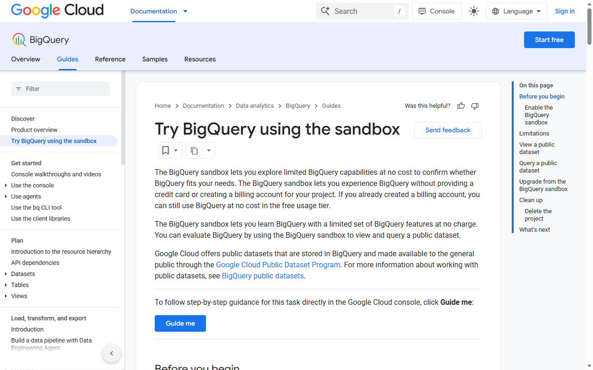
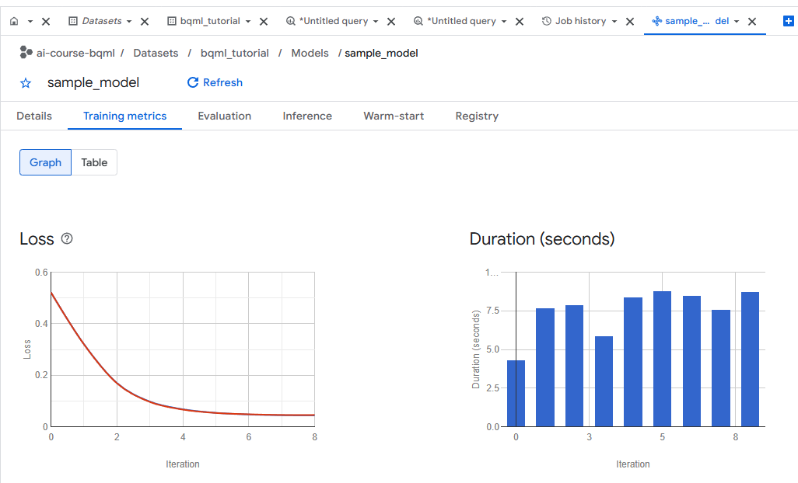
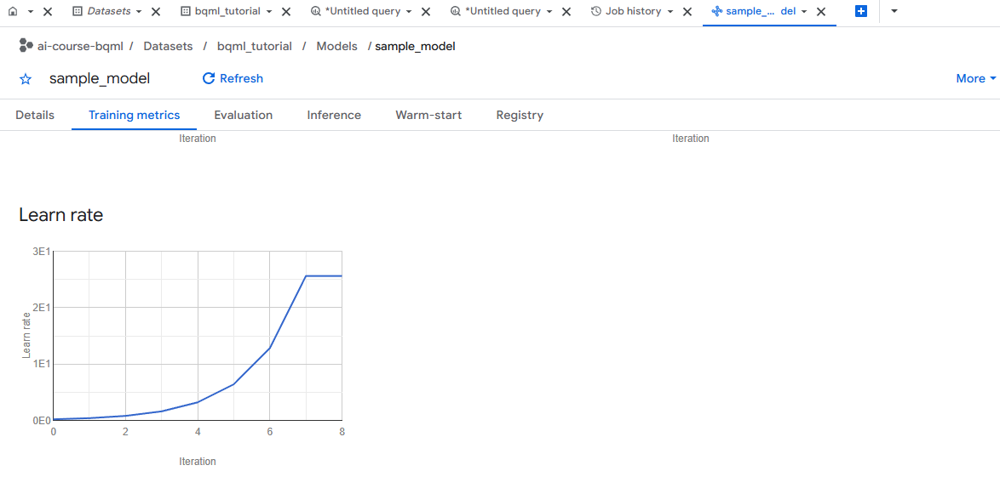
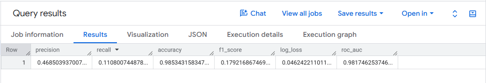

## What you will learn

### What we will do

Enable the no-card BigQuery sandbox, create a US dataset, inspect the public
Google Analytics session tables, train a logistic regression model with SQL on
earlier months, evaluate it on a holdout month, generate purchase predictions
and class probabilities, and compare the workflow with Azure Automated ML.

### Libraries and tools

Use the Google Cloud console (BigQuery Studio query editor) in a web browser
and save your SQL script in `week4/bqml.sql`. No Python SDK, billing card or
local database package is required for this exercise.

### Important calls and commands

`CREATE OR REPLACE MODEL ... OPTIONS(model_type = 'logistic_reg') AS SELECT ...`
trains the classifier directly from a query. `ML.EVALUATE` computes precision,
recall, accuracy, F1, log loss and ROC AUC on unseen July 2017 sessions.
`ML.PREDICT` produces `predicted_label` and `predicted_label_probs`, and
`ML.TRAINING_INFO` inspects iteration loss. Check the query bytes estimate
before running each statement.

### Expected results

Create `sample_model` in `bqml_tutorial`, inspect evaluation metrics on rare
purchase events (high accuracy and ROC AUC, low recall at the default 0.5
threshold), rank predicted purchases by country, inspect per-class
probabilities, delete the dataset during cleanup and commit `bqml.sql` and
`cloud_comparison.md`.

### Connection to agentic AI

Tabular ML models and SQL prediction queries can serve as analytical tools or
scoring backends that an agent invokes when structured forecasting or
classification is more appropriate than free-text generation. This lab teaches
in-warehouse classical ML, not an autonomous agent.

[All student labs](../../../../README.md) |
[Prerequisite: Google Lab 3](../03-GAIS-Lab-Function-Calling/README.md) |
[Related: AWS Lab 3 (SageMaker AI walkthrough)](../../03-AWS/03-AWS-Lab-SageMaker-AI/README.md)

Complete the steps in your separate portfolio repository. The BigQuery sandbox
requires no credit card or billing account; stay within sandbox storage and
query limits, and delete your dataset when finished. Source testing notes below
are historical, not a new live-cloud validation.

## Lab Overview

| Field | Details |
| --- | --- |
| Lab type | Hands-on lab |
| Course slide | Slide 335 · Week 4, Session 3 · Wed 28 Oct 2026 |
| Expected duration | 45 to 60 minutes |
| Environment | Google Cloud console (BigQuery) in a web browser |
| Account and cost | BigQuery sandbox: no card; 10 GiB storage, 1 TiB of queries per month |
| Related labs | Skillable Azure Machine Learning exercises (Automated ML); AWS Lab 3 (SageMaker demo) |
| Public docs | [Create a machine learning model in BigQuery ML by using SQL](https://docs.cloud.google.com/bigquery/docs/create-machine-learning-model) |
| Tested | 2026-10-09 · see the note at the end of the lab |

## Before you start

You need one personal Google account (Gmail) for all four Google labs. You must be 18 or older. The United Arab Emirates is a supported country for Google AI Studio and the Gemini API ([available regions](https://ai.google.dev/gemini-api/docs/available-regions)). Turn off any VPN.

* The **BigQuery sandbox** needs no credit card and no billing account.
* Sandbox limits: 10 GiB of storage, 1 TiB of query processing per month, tables expire after 60 days, and no INSERT, UPDATE or DELETE statements. `CREATE MODEL` works.
* Use a personal Google account. Accounts managed by a school may be forced to choose an organization; a personal Gmail account avoids that.



Values that you type or select are shown like this: example.

When you are ready, continue below to start the exercise.

## Train and evaluate a BigQuery ML model with SQL

In this exercise, you enable the BigQuery sandbox, create a dataset, train a logistic regression model on the public Google Analytics sample with one SQL statement, evaluate it on a later month, make predictions, and compare the workflow with Azure Automated ML.

> [!IMPORTANT]
> Training takes several minutes. Start the `CREATE MODEL` statement as soon as your dataset exists, then read the explanation while it runs.

This exercise takes approximately **45** minutes.

## Open the BigQuery sandbox

1. In a web browser, open <https://console.cloud.google.com/bigquery> at `https://console.cloud.google.com/bigquery` and sign in with your personal Google account.
2. On the welcome page, select your country (`United Arab Emirates`), accept the Terms of Service and select **Agree and continue**.
3. Select **Create project**. Enter the project name `ai-course-bqml`, set **Location** to `No organization` and select **Create**.

   You return to BigQuery with a **sandbox** notice at the top of the page. If you already have a Google Cloud Free Trial project, you can use it instead; the steps are the same.

## Create a dataset

1. In the left pane, select **Explorer**, expand your project and select **Datasets**. Then select **Create dataset**.
2. Set **Dataset ID** to `bqml_tutorial` and **Data location** to `US`. Leave the other settings and select **Create dataset**.

   > **Note**: The public dataset is stored in the US multi-region. The training query and the dataset must be in compatible locations, which is why you choose US.

## Explore the public data

1. Select **+** (new query) and paste this query. **Before you run it**, read the estimate at the top right of the editor ("This query will process ... when run").

   ```sql
   SELECT device.operatingSystem, device.isMobile, geoNetwork.country,
          totals.pageviews, totals.transactions
   FROM `bigquery-public-data.google_analytics_sample.ga_sessions_20170801`
   LIMIT 20;
   ```

2. Select **Run**. Ask yourself why `LIMIT 20` does not reduce the estimate. (BigQuery reads whole columns; `LIMIT` only trims the result. Select only the columns you need.)
3. The question for the model: does a website session end with a purchase? The features are the operating system, whether the device is mobile, the country and the number of page views.

## Train the model

1. Open a new query tab, paste the following statement and select **Run**:

   ```sql
   CREATE OR REPLACE MODEL `bqml_tutorial.sample_model`
   OPTIONS(model_type = 'logistic_reg') AS
   SELECT
     IF(totals.transactions IS NULL, 0, 1) AS label,
     IFNULL(device.operatingSystem, "") AS os,
     device.isMobile AS is_mobile,
     IFNULL(geoNetwork.country, "") AS country,
     IFNULL(totals.pageviews, 0) AS pageviews
   FROM `bigquery-public-data.google_analytics_sample.ga_sessions_*`
   WHERE _TABLE_SUFFIX BETWEEN '20160801' AND '20170630';
   ```

2. While it trains, read what the statement does:

   * The column named `label` is the target (1 if the session had a transaction). Every other column is a feature.
   * BigQuery ML one-hot encodes the text columns automatically.
   * The wildcard table plus `_TABLE_SUFFIX` selects one table per day from August 2016 to June 2017.
   * BigQuery ML keeps part of the training data aside for its own evaluation during training.

3. When the statement finishes, `sample_model` appears under `bqml_tutorial` on the **Models** tab. Open it and look at the **Training metrics** tab: the loss graph should go down with each iteration.

   

   

   ### How to read the three Training metrics graphs

   For a complete offline visual walkthrough, open [training-metrics-tutorial.html](training-metrics-tutorial.html) in Microsoft Edge. Here is what each of the three graphs tells you about your `CREATE OR REPLACE MODEL` run across iterations `0` to `8`:

   | Graph | Axes | What Happens in `sample_model` | How to Interpret It |
   | --- | --- | --- | --- |
   | **1. Loss** (Line chart) | **X:** Iteration (`0`–`8`)<br>**Y:** Log Loss (Binary Cross-Entropy) | Starts around `0.52` at Iteration 0, drops steeply to `~0.17` by Iteration 2, and flattens near `0.046` at Iterations 6–8. | Measures how wrong the predicted purchase probabilities are. A smooth downward curve that levels off means the model **converged** cleanly. BigQuery ML stops early at Iteration 8 (instead of running all 20 default iterations) because relative improvement fell below 1% (`min_rel_progress = 0.01`). |
   | **2. Duration (seconds)** (Bar chart) | **X:** Iteration (`0`–`8`)<br>**Y:** Wall-clock seconds per iteration | Iteration 0 takes `~4.3 s`; Iterations 1–8 take `~5.8 s` to `~8.8 s` each (~65–70 s total iteration time). | Shows the compute time per gradient-descent pass over the 11 months of sessions. Uniform bar heights confirm stable distributed execution with no bottleneck spikes. |
   | **3. Learn rate** (Line chart) | **X:** Iteration (`0`–`8`)<br>**Y:** Step size (`0E0` = 0, `1E1` = 10, `2E1` = 20, `3E1` = 30) | Starts at `0.1` (`0.01E1`) and doubles on each successful step (`0.2 → 0.4 → 0.8 → 1.6 → 3.2 → 6.4 → 12.8 → 25.6`), plateauing at `25.6` (`2.56E1`) on Iterations 7–8. | BigQuery ML defaults to `learn_rate_strategy = 'LINE_SEARCH'`, which automatically **doubles** the step size whenever a step reduces loss. As the loss curve flattens near the minimum, gradients become tiny, so a larger multiplier (`25.6`) still produces safe, small weight updates. |

## Evaluate on a later month

1. Run the evaluation on July 2017, a month the model did not see:

   ```sql
   SELECT *
   FROM ML.EVALUATE(MODEL `bqml_tutorial.sample_model`, (
     SELECT
       IF(totals.transactions IS NULL, 0, 1) AS label,
       IFNULL(device.operatingSystem, "") AS os,
       device.isMobile AS is_mobile,
       IFNULL(geoNetwork.country, "") AS country,
       IFNULL(totals.pageviews, 0) AS pageviews
     FROM `bigquery-public-data.google_analytics_sample.ga_sessions_*`
     WHERE _TABLE_SUFFIX BETWEEN '20170701' AND '20170801'));
   ```

2. Compare your result with Google's tutorial run, which reports values close to these:

   

   | precision | recall | accuracy | f1_score | log_loss | roc_auc |
   | --- | --- | --- | --- | --- | --- |
   | 0.469 | 0.111 | 0.985 | 0.179 | 0.046 | 0.982 |

   Is this a good model? Purchases are rare, so a model that always says "no purchase" is also about 98% accurate. Recall says the model finds only about one buyer in nine. ROC AUC is high, so the ranking of sessions is useful, even if the default 0.5 threshold is not. Training on earlier months and testing on a later month mirrors real use.

   ### Plain-English guide to the six evaluation metrics

   For a complete non-technical walkthrough with everyday analogies, open [evaluation-metrics-tutorial.html](evaluation-metrics-tutorial.html) in Microsoft Edge:

   | Metric | Your Result | Plain-English Meaning |
   | --- | --- | --- |
   | **`precision`** | `0.469` (**46.9%**) | **Quality of alarms:** When the model flags a visitor as a *Buyer*, it is right almost half the time (47 out of 100 flags are real buyers). |
   | **`recall`** | `0.111` (**11.1%**) | **Share of real buyers caught:** Out of all actual buyers who visited in July 2017, the model caught about 1 in 9 at the default 50% cutoff. |
   | **`accuracy`** | `0.985` (**98.5%**) | **Overall right guesses (can be misleading!):** Because 98.5% of visitors don't buy anything, simply guessing *"No purchase"* every time is also 98.5% accurate. |
   | **`f1_score`** | `0.179` (**17.9%**) | **Combined balance of Precision and Recall:** A strict average that stays low whenever either Precision or Recall is low. |
   | **`log_loss`** | `0.046` (*Lower is better, 0 = perfect*) | **Confidence penalty:** Measures how well-calibrated the model's probability percentages are, heavily penalizing confident wrong guesses. |
   | **`roc_auc`** | `0.982` (**98.2%**) | **Ranking superpower:** If you pick one real buyer and one non-buyer at random, the model gives the real buyer a higher score **98.2% of the time**. |

## Predict

1. Predict purchases per country for July 2017:

   ```sql
   SELECT country, SUM(predicted_label) AS total_predicted_purchases
   FROM ML.PREDICT(MODEL `bqml_tutorial.sample_model`, (
     SELECT
       IFNULL(device.operatingSystem, "") AS os,
       device.isMobile AS is_mobile,
       IFNULL(totals.pageviews, 0) AS pageviews,
       IFNULL(geoNetwork.country, "") AS country
     FROM `bigquery-public-data.google_analytics_sample.ga_sessions_*`
     WHERE _TABLE_SUFFIX BETWEEN '20170701' AND '20170801'))
   GROUP BY country
   ORDER BY total_predicted_purchases DESC
   LIMIT 10;
   ```

   In Google's run the United States leads with about 220 predicted purchases.

2. See the probability behind each prediction:

   ```sql
   SELECT predicted_label, predicted_label_probs, country, pageviews
   FROM ML.PREDICT(MODEL `bqml_tutorial.sample_model`, (
     SELECT
       IFNULL(device.operatingSystem, "") AS os,
       device.isMobile AS is_mobile,
       IFNULL(totals.pageviews, 0) AS pageviews,
       IFNULL(geoNetwork.country, "") AS country
     FROM `bigquery-public-data.google_analytics_sample.ga_sessions_20170801`))
   LIMIT 10;
   ```

   `predicted_label_probs` holds the probability of each class. A business could choose a lower threshold to find more buyers, at the cost of more false alarms.

3. Optional: look at the training iterations with SQL, then train a second model with `model_type = 'boosted_tree_classifier'` on the same `SELECT` and compare `ML.EVALUATE` results. Watch the bytes estimate and the training time.

   ```sql
   SELECT * FROM ML.TRAINING_INFO(MODEL `bqml_tutorial.sample_model`);
   ```

## Compare with Azure Automated ML

1. In `week4/cloud_comparison.md`, note for BigQuery ML and Azure Automated ML: the steps to a first model, the time to a first model, how metrics are shown, how predictions are served, and what you could not control. The datasets differ, so compare the workflow, not the accuracy.

   For a complete visual guide to the four Azure Machine Learning MLflow evaluation plots (Raw Confusion Matrix, Normalized Confusion Matrix, Precision-Recall Curve, and ROC Curve) generated in [mslearn-aml-cli Lab 04](https://microsoftlearning.github.io/mslearn-aml-cli/Instructions/Labs/04-use-mlflow-jobs.html), open [confusion-matrix-pr-roc-tutorial.html](confusion-matrix-pr-roc-tutorial.html) in Microsoft Edge.

   Save all statements in `week4/bqml.sql` in your repository.

The complete `bqml.sql` file:

```sql
-- Google Lab 4: BigQuery ML in the BigQuery sandbox.
-- Run each statement separately in the BigQuery query editor.

-- 1. Look at the data (read the bytes estimate before you run it).
SELECT device.operatingSystem, device.isMobile, geoNetwork.country,
       totals.pageviews, totals.transactions
FROM `bigquery-public-data.google_analytics_sample.ga_sessions_20170801`
LIMIT 20;

-- 2. Train a logistic regression model on August 2016 to June 2017.
CREATE OR REPLACE MODEL `bqml_tutorial.sample_model`
OPTIONS(model_type = 'logistic_reg') AS
SELECT
  IF(totals.transactions IS NULL, 0, 1) AS label,
  IFNULL(device.operatingSystem, "") AS os,
  device.isMobile AS is_mobile,
  IFNULL(geoNetwork.country, "") AS country,
  IFNULL(totals.pageviews, 0) AS pageviews
FROM `bigquery-public-data.google_analytics_sample.ga_sessions_*`
WHERE _TABLE_SUFFIX BETWEEN '20160801' AND '20170630';

-- 3. Evaluate on later data (July 2017).
SELECT *
FROM ML.EVALUATE(MODEL `bqml_tutorial.sample_model`, (
  SELECT
    IF(totals.transactions IS NULL, 0, 1) AS label,
    IFNULL(device.operatingSystem, "") AS os,
    device.isMobile AS is_mobile,
    IFNULL(geoNetwork.country, "") AS country,
    IFNULL(totals.pageviews, 0) AS pageviews
  FROM `bigquery-public-data.google_analytics_sample.ga_sessions_*`
  WHERE _TABLE_SUFFIX BETWEEN '20170701' AND '20170801'));

-- 4. Predict purchases per country.
SELECT country, SUM(predicted_label) AS total_predicted_purchases
FROM ML.PREDICT(MODEL `bqml_tutorial.sample_model`, (
  SELECT
    IFNULL(device.operatingSystem, "") AS os,
    device.isMobile AS is_mobile,
    IFNULL(totals.pageviews, 0) AS pageviews,
    IFNULL(geoNetwork.country, "") AS country
  FROM `bigquery-public-data.google_analytics_sample.ga_sessions_*`
  WHERE _TABLE_SUFFIX BETWEEN '20170701' AND '20170801'))
GROUP BY country
ORDER BY total_predicted_purchases DESC
LIMIT 10;

-- 5. See the probabilities behind each prediction (first 10 rows).
SELECT predicted_label, predicted_label_probs, country, pageviews
FROM ML.PREDICT(MODEL `bqml_tutorial.sample_model`, (
  SELECT
    IFNULL(device.operatingSystem, "") AS os,
    device.isMobile AS is_mobile,
    IFNULL(totals.pageviews, 0) AS pageviews,
    IFNULL(geoNetwork.country, "") AS country
  FROM `bigquery-public-data.google_analytics_sample.ga_sessions_20170801`))
LIMIT 10;

-- 6. Training details: one row per iteration with the loss.
SELECT * FROM ML.TRAINING_INFO(MODEL `bqml_tutorial.sample_model`);
```

## Troubleshooting

* `Not found: Dataset ... was not found in location`: the dataset is not in US; create it again with location US.
* `Access Denied: ... bigquery.jobs.create`: the wrong project is selected in the project picker at the top of the page.
* DML errors in the sandbox: INSERT, UPDATE and DELETE are not supported there; CREATE MODEL is.
* "Organization required": you used a school-managed account; use a personal Gmail account.

## Summary

You trained, evaluated and used a classification model with SQL only, read precision, recall and ROC AUC on imbalanced data, and compared BigQuery ML with Azure Automated ML.

## Clean up

1. In **Explorer**, expand your project, select **Datasets**, select `bqml_tutorial` and choose **Delete**. Type `delete` to confirm.
2. Sandbox tables expire after 60 days anyway. If you used a Free Trial project, also check **Billing** for credit usage.

### End the lab

Commit `bqml.sql`, a copy of your evaluation metrics, two sentences that interpret precision and recall, and `cloud_comparison.md`.

### How this lab was tested

The SQL statements match Google's tutorial "Create a machine learning model in BigQuery ML by using SQL" (page updated 2026-10-08), which is the source of the expected metrics and predictions. The console steps need a signed-in account and are therefore described, not shown.
