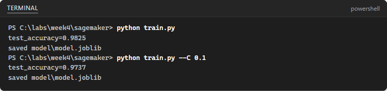

## What you will learn

### What we will do

Test a scikit-learn classifier locally on your laptop (`train.py`), then
observe the instructor walkthrough of Amazon SageMaker AI: domain and user
profile quick setup, SageMaker Studio, a JupyterLab space, a managed training
job with the SageMaker Python SDK v2, the model registry and endpoint options,
and complete cleanup. Map each concept across Azure Machine Learning, Google
Cloud and Amazon SageMaker AI in `week4/cloud_comparison.md`.

### Libraries and tools

Use `scikit-learn` and `joblib` locally to test `train.py` before any cloud
compute is used. In the instructor's SageMaker Studio JupyterLab space, the
demo uses `sagemaker>=2.250,<3` (`SKLearn` estimator, framework `1.4-2`) and
the AWS Management Console.

### Important calls and commands

Locally, `load_breast_cancer()`, `make_pipeline(StandardScaler(), LogisticRegression(...))`
and `joblib.dump()` train and save the classifier to `SM_MODEL_DIR` (or
`./model` locally) and print `test_accuracy=...`. In Studio,
`sagemaker.get_execution_role()`, `SKLearn(...)` and `estimator.fit(wait=True)`
run the same script as a managed training job and extract `test:accuracy` from
logs via `metric_definitions`.

### Expected results

Locally, running `python train.py` and `python train.py --C 0.1` prints
`test_accuracy=...` and writes `model/model.joblib`. During the instructor
walkthrough, students complete and commit the three-cloud comparison table in
`week4/cloud_comparison.md`, while the instructor stops the JupyterLab space
and deletes any demo endpoints, models and domain resources.

### Connection to agentic AI

Managed ML platforms train, track, register and host specialized models that
agents can call as tools or routers alongside foundation models. Understanding
where compute runs and which resources bill continuously (spaces and endpoints)
is essential for operating ML and agent infrastructure safely.

[All student labs](../../../../README.md) |
[AWS setup](../00-AWS-Lab-Setup-AWS/README.md) |
[Prerequisite: AWS Lab 1](../01-AWS-Lab-bedrock/README.md) |
[Related: Google Lab 4 (BigQuery ML)](../../02-Google-AI-Studio/04-GAIS-Lab-BigQuery-ML/README.md)

Complete the local script test and your three-cloud comparison table in your
separate portfolio repository. This cloud walkthrough is an **instructor demo**:
students observe the SageMaker Studio and managed training job steps and record
observations without provisioning billable SageMaker domains, spaces or
endpoints in student accounts unless explicitly instructed. Source testing
notes below are historical, not a new live-cloud validation.

## Lab Overview

| Field | Details |
| --- | --- |
| Lab type | Instructor demo; students record observations |
| Course slide | Slide 337 · Week 4, Session 3 · Wed 28 Oct 2026 |
| Expected duration | 20 to 30 minutes plus discussion |
| Environment | AWS Management Console and SageMaker Studio |
| Account and cost | Billable while running: notebook spaces, training jobs and endpoints. Stop and delete after the demo. |
| Related labs | Skillable Azure Machine Learning exercises (jobs, MLflow); Google Lab 4 (BigQuery ML) |
| Public docs | [Set up SageMaker AI for single users](https://docs.aws.amazon.com/sagemaker/latest/dg/onboard-quick-start.html) · [scikit-learn with the SageMaker Python SDK (v2)](https://sagemaker.readthedocs.io/en/v2/frameworks/sklearn/using_sklearn.html) |
| Tested | 2026-10-09 · see the note at the end of the lab |

## Before you start

Use the same AWS account in all six AWS labs: the account on the **Free plan** that you create in AWS Lab 1. Sign in at <https://console.aws.amazon.com> at `https://console.aws.amazon.com`.

* Region: select **US East (N. Virginia) us-east-1** in the Region selector at the top right of the console, unless a step says otherwise.
* Before you start, check that MFA is on for the root user and that your **Zero spend budget** exists (AWS Lab 1, Part C). A budget sends alerts; it does not stop spending.
* Delete everything you create before you finish the lab. Each lab ends with a clean-up list.
* Use only synthetic or public data and your own voice and photos. No personal data of other people.

Values that you type or select are shown like this: example. AWS console screens change from time to time; if a button has a slightly different name, look for the closest match.

> **Trainer note**: Practice the demo once before class and create the domain about 15 minutes early: quick setup takes several minutes. If quick setup fails (for example because of a missing default VPC), show screenshots you prepared instead of debugging live.

When you are ready, continue below to start the exercise.

## Amazon SageMaker AI walkthrough (instructor demo)

In this demo, the instructor tours Amazon SageMaker AI, the AWS counterpart of Azure Machine Learning: a domain with a user profile, SageMaker Studio, a JupyterLab space, a managed training job, the model registry and endpoints. Students set up `week3\AWS` locally, run `train.py` in a virtual environment, and map each cloud concept to Azure and Google Cloud in the three-cloud table.

This exercise takes approximately **30** minutes.

## Set up the project

1. In VS Code, open your portfolio repository and create the folder `week3\AWS`. Right-click the folder and select **Open in Integrated Terminal** (or run the commands below from your repository root to create and enter `week3\AWS`):

   ```powershell
   New-Item -ItemType Directory -Force -Path week3\AWS
   Set-Location week3\AWS
   ```

2. Create and activate a virtual environment, install `scikit-learn` and `joblib`, and create a `.gitignore` file so the virtual environment and generated model artefacts are not committed to Git:

   ```powershell
   python -m venv .venv
   .venv\Scripts\Activate.ps1
   pip install -U scikit-learn joblib
   Set-Content .gitignore ".venv/`nmodel/"
   ```

   On macOS or Linux use `source .venv/bin/activate` instead of `.venv\Scripts\Activate.ps1`.

## Test the training script locally first

A managed training job runs a script on a fresh instance. Test the script on a laptop before paying for an instance.

1. Inside `week3\AWS`, create `train.py` (it uses the breast cancer dataset that ships with scikit-learn, so no upload is needed):

   ```python
   """Train a scikit-learn classifier. The same script runs on your laptop and as a SageMaker training job."""
   import argparse
   import os

   import joblib
   from sklearn.datasets import load_breast_cancer
   from sklearn.linear_model import LogisticRegression
   from sklearn.metrics import accuracy_score
   from sklearn.model_selection import train_test_split
   from sklearn.pipeline import make_pipeline
   from sklearn.preprocessing import StandardScaler


   def main():
       parser = argparse.ArgumentParser()
       parser.add_argument("--C", type=float, default=1.0)  # hyperparameter passed by SageMaker
       # SageMaker sets SM_MODEL_DIR=/opt/ml/model; on your laptop the model goes to ./model
       parser.add_argument("--model-dir", default=os.environ.get("SM_MODEL_DIR", "model"))
       args = parser.parse_args()

       X, y = load_breast_cancer(return_X_y=True)
       X_train, X_test, y_train, y_test = train_test_split(X, y, test_size=0.2, stratify=y, random_state=42)
       model = make_pipeline(StandardScaler(), LogisticRegression(C=args.C, max_iter=1000))
       model.fit(X_train, y_train)
       accuracy = accuracy_score(y_test, model.predict(X_test))
       print(f"test_accuracy={accuracy:.4f}")  # the training job parses this line as a metric

       os.makedirs(args.model_dir, exist_ok=True)
       path = os.path.join(args.model_dir, "model.joblib")
       joblib.dump(model, path)
       print("saved", path)


   if __name__ == "__main__":
       main()
   ```

2. Ensure your virtual environment is started in the terminal (if it is not already active from the setup step, activate it now):

   ```powershell
   .venv\Scripts\Activate.ps1
   ```

   On macOS or Linux run `source .venv/bin/activate`.

3. In a virtual environment with `scikit-learn` and `joblib` installed, run it twice:

   ```powershell
   python train.py
   python train.py --C 0.1
   ```

   

   The script prints `test_accuracy=...` (the training job turns this line into a metric) and saves the model to `model/model.joblib`. In SageMaker, `SM_MODEL_DIR` points to `/opt/ml/model` instead.

## Create a domain with quick setup

1. Sign in to the console, choose `us-east-1`, open **Amazon SageMaker AI** and select **Domains**, then **Create domain** and **Set up for single user (Quick setup)**.
2. Explain what quick setup creates: a domain (named QuickSetupDomain with a timestamp), a user profile, and an IAM execution role with broad SageMaker permissions. In a company you would scope this role more tightly (least privilege).

## Tour SageMaker Studio

1. Open the domain, select the user profile and choose **Launch**, then **Studio**.
2. Show the home page: JupyterLab and Code Editor spaces, training jobs, models, experiments and MLflow, JumpStart pre-trained models, and pipelines.
3. Create a JupyterLab space with a small instance type such as `ml.t3.medium`, start it and open it. A running space bills like an Azure Machine Learning compute instance.

## Run a managed training job

1. In the JupyterLab space, upload `train.py` and run `!python train.py` in a notebook cell: interactive training on the notebook instance.
2. In the next cells, start a managed training job with the SageMaker Python SDK. This demo uses the SDK v2 estimator API, so pin it first:

   ```python
   %pip install -q "sagemaker>=2.250,<3"
   ```

   ```python
   # Run in a JupyterLab space in SageMaker Studio, in the same folder as train.py.
   # First notebook cell:  %pip install -q "sagemaker>=2.250,<3"   (this demo uses the SDK v2 estimator API)
   import sagemaker
   from sagemaker.sklearn.estimator import SKLearn

   role = sagemaker.get_execution_role()  # the execution role that quick setup created
   estimator = SKLearn(
       entry_point="train.py",
       framework_version="1.4-2",
       py_version="py3",
       role=role,
       instance_type="ml.m5.large",
       instance_count=1,
       hyperparameters={"C": 1.0},
       metric_definitions=[{"Name": "test:accuracy", "Regex": "test_accuracy=([0-9\\.]+)"}],
   )
   estimator.fit(wait=True)  # starts a managed training job and streams its logs here
   print("Model artefact:", estimator.model_data)
   ```

   > **Note**: SDK v3 is now the default release and uses a different training API. Pinning v2 keeps this demo stable; `1.4-2` is the newest scikit-learn container version listed by SDK v2.

3. Open the **Training jobs** page in the console and show the job: status history, instance type, duration, the `test:accuracy` metric and the CloudWatch logs. Compare with the Jobs page in Azure Machine Learning studio.
4. Explain the model registry (model groups, versions, approval status) and the deployment options: real-time, serverless and asynchronous endpoints, and batch transform. If you deploy a real-time endpoint for the demo, call it once and delete it immediately; an idle endpoint keeps billing.

## What students record

| Concept | Azure Machine Learning | Google Cloud | Amazon SageMaker AI |
| --- | --- | --- | --- |
| Workspace or project |  |  | Domain and user profile |
| Interactive compute |  |  | JupyterLab space |
| Training |  |  | Notebooks, training jobs, built-in algorithms, JumpStart |
| AutoML |  |  | Autopilot capabilities in SageMaker Canvas |
| Experiment tracking |  |  | Experiments and managed MLflow |
| Deployment |  |  | Real-time, serverless, asynchronous, batch |
| Cost controls |  |  | Stop spaces, delete endpoints, AWS Budgets, Free plan credits |

Discussion: which concepts map one-to-one to Azure Machine Learning? Where is the biggest cost risk? (Running spaces and endpoints.) Which platform would you choose for a team whose data is already in Amazon S3?

## Summary

The same machine learning concepts exist on every cloud under different names. Learn the concept once, then map the names and the cost risks.

## Clean up

1. Stop the JupyterLab space.
2. Delete any endpoint, endpoint configuration and model. Training jobs stop on their own.
3. If you no longer need the domain, delete its spaces and user profiles first, then the domain. Its storage volume is kept unless you delete it.
4. Open [Billing and Cost Management](https://console.aws.amazon.com/billing/) and check **Bills** and **Credits**.

### End the lab

Students commit `week3/AWS/train.py`, `week3/AWS/.gitignore`, and the completed three-cloud table in `week4/cloud_comparison.md`.

### How this lab was tested

On 2026-10-09 `train.py` was run locally as shown (scikit-learn 1.9). The estimator parameters and the `1.4-2` framework version were checked against the SageMaker Python SDK 2.257.6 package. Console steps need a signed-in account and are described, not shown.
