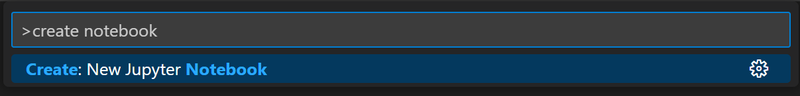
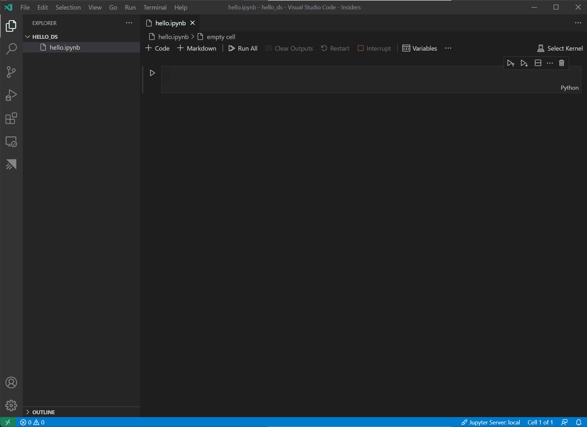
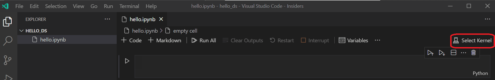
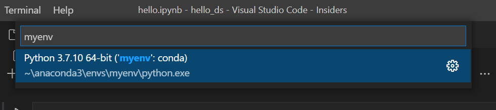

## What you will learn

### What we will do

Install and verify Visual Studio Code, the Microsoft Python and Jupyter
extensions, and Miniconda (or a Python virtual environment), install the
required data science and machine learning packages, create the `hello_ds`
workspace folder, initialize the `datascience-using-jupyter.ipynb` notebook,
select the environment kernel, and verify the active Python executable.

### Libraries and tools

Use Visual Studio Code, the Microsoft Python extension (`ms-python.python`),
the Microsoft Jupyter extension (`ms-toolsai.jupyter`), and Miniconda or
Anaconda (or Python's built-in `venv` and `pip`). Install `pandas`, `jupyter`,
`seaborn`, `scikit-learn`, `keras`, and `tensorflow` (which also pulls in
`numpy` and `matplotlib`).

### Important calls and commands

`conda create -n myenv python=3.10 pandas jupyter seaborn scikit-learn keras tensorflow`
creates an isolated Conda environment with the required packages. Alternatively,
`python -m pip install pandas jupyter seaborn scikit-learn keras tensorflow`
installs them into a virtual environment, and
`python -m pip show pandas jupyter seaborn scikit-learn keras tensorflow`
verifies package versions. `conda activate myenv` activates the environment in
the integrated terminal, `conda info --envs` lists available Conda environments,
and `import sys; print(sys.executable)` inside a notebook code cell confirms
that the notebook kernel points to your environment's Python binary.

### Expected results

You have a dedicated `myenv` environment containing all six data science and
deep learning libraries, a `hello_ds` project folder in your separate work
repository, an open `datascience-using-jupyter.ipynb` notebook connected to the
`myenv` kernel, and cell output showing `sys.executable` resolving to your
isolated environment.

### Connection to agentic AI

Interactive Jupyter notebooks give AI engineers a reproducible workbench to
inspect raw data, engineer features, and benchmark classical machine learning
and deep learning models before wrapping those models as callable tools or
microservices for an agent. This setup prepares that local kernel boundary; it
does not invoke a cloud API or build an autonomous agent.

## Start here

[All student labs](../../../../README.md) |
[00-Setup-Lab](../../00-Setup-Lab/README.md) |
[Python setup](../../01-Python/00-Python-Lab-Setup-Python/README.md) |
[Next: 01-DSJN-Data-Science-Using-Jupyter-Notebook](../01-DSJN-Data-Science-Using-Jupyter-Notebook/README.md)

This setup splits out the environment preparation portion of the official
[Data Science in VS Code tutorial](https://code.visualstudio.com/docs/datascience/data-science-tutorial)
so you can verify your local Jupyter kernel, Conda or virtual environment, and
package installations before starting the Titanic data science workflow in
[01-DSJN-Data-Science-Using-Jupyter-Notebook](../01-DSJN-Data-Science-Using-Jupyter-Notebook/README.md).
No cloud account, API key, or payment method is required.

## Lab Overview

| Field             | Details                                                                                                                           |
|-------------------|-----------------------------------------------------------------------------------------------------------------------------------|
| Lab type          | Hands-on setup lab                                                                                                                |
| Course module     | Module 04: Data Science by Jupyter Notebooks                                                                                      |
| Expected duration | 30 minutes                                                                                                                        |
| Environment       | Your laptop: Visual Studio Code, Python and Jupyter extensions, Miniconda or Python `venv`                                        |
| Account and cost  | Free local tools and open-source Python libraries; no cloud account required                                                      |
| Related labs      | [00-Python-Lab-Setup-Python](../../01-Python/00-Python-Lab-Setup-Python/README.md); [01-DSJN-Data-Science-Using-Jupyter-Notebook](../01-DSJN-Data-Science-Using-Jupyter-Notebook/README.md) |
| Public docs       | [Data Science in VS Code tutorial](https://code.visualstudio.com/docs/datascience/data-science-tutorial) · [Jupyter Notebooks in VS Code](https://code.visualstudio.com/docs/datascience/jupyter-notebooks) |
| Tested            | 2026-11-06 · see the note at the end of the lab                                                                                   |

## Prerequisites

The following installations are required for the completion of this tutorial.
Make sure to install them if you have not already:

* [Visual Studio Code](https://code.visualstudio.com/)
* The [Python extension for VS Code](https://marketplace.visualstudio.com/items?itemName=ms-python.python) and [Jupyter extension for VS Code](https://marketplace.visualstudio.com/items?itemName=ms-toolsai.jupyter) from the Visual Studio Marketplace. For more details on installing extensions, see [Extension Marketplace](https://code.visualstudio.com/docs/configure/extensions/extension-marketplace). Both extensions are published by Microsoft.
* [Miniconda with latest Python](https://docs.anaconda.com/miniconda/) (also available via <https://docs.conda.io/en/latest/miniconda.html>)

> [!NOTE]
> If you already have the full Anaconda distribution installed, you do not need
> to install Miniconda. Alternatively, if you prefer not to use Anaconda or
> Miniconda, you can create a Python virtual environment and install the
> packages needed for the tutorial using `pip`. If you go this route, install
> the following packages: `pandas`, `jupyter`, `seaborn`, `scikit-learn`,
> `keras`, and `tensorflow`:
>
> ```powershell
> python -m pip install pandas jupyter seaborn scikit-learn keras tensorflow
>
> # Verify installations
> python -m pip show pandas jupyter seaborn scikit-learn keras tensorflow
> ```

## Set up a data science environment

Visual Studio Code and the Python extension provide an interactive editor for
data science scenarios. With native support for Jupyter notebooks combined with
Anaconda or Miniconda, you can manage isolated kernels alongside your code. In
this section, you create a workspace for the tutorial, create an environment
with the data science modules needed for the tutorial, and create the Jupyter
notebook that you will use to train and compare two machine learning models in
the next lab.

1. Begin by creating an Anaconda or Miniconda environment for the data science
   tutorial. Open an Anaconda command prompt (or your terminal with Conda on
   `PATH`) and run the following command to create an environment named
   `myenv`:

   ```powershell
   conda create -n myenv python=3.10 pandas jupyter seaborn scikit-learn keras tensorflow
   ```

   For additional information about creating and managing Anaconda
   environments, see the [Anaconda documentation](https://docs.conda.io/projects/conda/en/latest/user-guide/tasks/manage-environments.html).

   > [!TIP]
   > If you are using a standard Python virtual environment instead of Conda,
   > create and populate `.venv` inside your project folder:
   >
   > ```powershell
   > python -m venv .venv
   > .\.venv\Scripts\Activate.ps1
   > python -m pip install pandas jupyter seaborn scikit-learn keras tensorflow
   > python -m pip show pandas jupyter seaborn scikit-learn keras tensorflow
   > ```

2. Next, create a folder in your separate work/portfolio repository to serve as
   your VS Code workspace for the tutorial, and name it `hello_ds`:

   ```powershell
   New-Item -ItemType Directory -Force -Path hello_ds
   Set-Location hello_ds
   ```

3. Open the project folder in VS Code by running VS Code and using the
   **File** > **Open Folder** command (or running `code .` inside `hello_ds`).
   You can safely trust opening the folder, since you created it.

4. Once VS Code launches, create the Jupyter notebook that will be used for the
   tutorial. Open the Command Palette (`Ctrl+Shift+P` on Windows/Linux,
   `⇧⌘P` on macOS) and select **Create: New Jupyter Notebook**.

   

   > [!NOTE]
   > Alternatively, from the VS Code File Explorer, you can use the **New File**
   > icon to create a notebook file named `datascience-using-jupyter.ipynb` (the
   > upstream VS Code tutorial also uses the name `hello.ipynb`).

5. Save the file as `datascience-using-jupyter.ipynb` using **File** >
   **Save As...**.

6. After your file is created, you will see the open [Jupyter notebook](https://jupyter.org/)
   in the notebook editor. For additional information about native Jupyter
   notebook support, read the [Jupyter Notebooks in VS Code](https://code.visualstudio.com/docs/datascience/jupyter-notebooks)
   documentation.

   

7. Select **Select Kernel** at the top right of the notebook.

   

8. Choose the Python environment you created above (`myenv`) in which to run
   your kernel. This ensures that the notebook uses the Python environment with
   all the required data science and deep learning packages installed.

   

9. Verify that the expected kernel is selected by adding a code cell in
   `datascience-using-jupyter.ipynb` and running (`Shift+Enter`):

   ```python
   import sys
   print(sys.executable)
   ```

   The output should point to the Python executable within your Conda or
   virtual environment, for example:

   ```text
   c:\Users\<your-user>\AppData\Local\miniconda3\envs\myenv\python.exe
   ```

10. To manage your environment from VS Code's integrated terminal, open the
    terminal with `` Ctrl+` `` (macOS `` ⌃` ``). If your environment is not
    activated, activate it in your terminal:

    ```powershell
    conda activate myenv
    ```

    Verify that the environment is active by running:

    ```powershell
    conda info --envs
    ```

    The active environment will be indicated with an asterisk (`*`).

## Record setup notes in your notebook

To match the structure of `datascience-using-jupyter.ipynb`, you can add
Markdown cells at the top of your notebook documenting the prerequisites,
installation commands, and kernel check before moving on to data preparation in
the next lab:

1. Markdown cell:

   ```markdown
   Prerequisites
   The following installations are required for the completion of this tutorial. Make sure to install them if you haven't already.

   Visual Studio Code

   The Python extension for VS Code and Jupyter extension for VS Code from the Visual Studio Marketplace. Both extensions are published by Microsoft.

   Miniconda with latest Python: https://docs.conda.io/en/latest/miniconda.html

   First install all the required frameworks and libraries:
   ```

2. Markdown cell:

   ```markdown
   python -m pip install pandas jupyter seaborn scikit-learn keras tensorflow

   # Verify installations
   python -m pip show pandas jupyter seaborn scikit-learn keras tensorflow
   ```

3. Markdown cell:

   ```markdown
   Create an Anaconda virtual environment using the following command:
   conda create -n myenv python=3.10 pandas jupyter seaborn scikit-learn keras tensorflow
   ```

4. Code cell:

   ```python
   import sys
   print(sys.executable)
   ```

## Acceptance and evidence

Record a sanitized checklist in your separate work repository:

| Check                   | Required evidence                                                                  |
|-------------------------|------------------------------------------------------------------------------------|
| VS Code extensions      | Microsoft Python (`ms-python.python`) and Jupyter (`ms-toolsai.jupyter`) installed |
| Environment creation    | `myenv` (or `.venv`) created with `pandas`, `jupyter`, `seaborn`, `scikit-learn`, `keras`, `tensorflow` |
| Package verification    | `python -m pip show pandas jupyter seaborn scikit-learn keras tensorflow` succeeds |
| Workspace and notebook  | `hello_ds/datascience-using-jupyter.ipynb` created in your separate work repository |
| Kernel verification     | `print(sys.executable)` outputs your environment's Python executable path          |
| Terminal verification   | `conda info --envs` marks your active environment with `*`                         |

## Troubleshooting and cleanup

* **Kernel not listed in Select Kernel**: run `python -m pip install ipykernel jupyter` inside your environment, then reload the VS Code window (`Ctrl+Shift+P` > **Developer: Reload Window**).
* **`conda` is not recognized in PowerShell**: open **Anaconda PowerShell Prompt (Miniconda3)** and run `conda init powershell`, then reopen your VS Code integrated terminal.
* **TensorFlow installation error on newer Python versions**: TensorFlow wheels support specific Python minor versions (such as Python 3.10 through 3.12). Creating the Conda environment with `python=3.10` or `python=3.11` avoids missing-wheel errors.
* **Git status shows environment files**: ensure `.venv/`, `.conda/`, and `__pycache__/` are listed in `.gitignore` in your work repository.

No cloud resources or billable services are created in this setup. Keep your
`hello_ds` folder and `datascience-using-jupyter.ipynb` open for
[01-DSJN-Data-Science-Using-Jupyter-Notebook](../01-DSJN-Data-Science-Using-Jupyter-Notebook/README.md).

## Official sources and validation limits

This setup lab adapts the Prerequisites and Environment Setup sections of the
Visual Studio Code documentation and the opening setup cells of
`datascience-using-jupyter.ipynb`.

* [Data Science in VS Code tutorial](https://code.visualstudio.com/docs/datascience/data-science-tutorial)
* [Working with Jupyter Notebooks in VS Code](https://code.visualstudio.com/docs/datascience/jupyter-notebooks)
* [Manage Conda environments](https://docs.conda.io/projects/conda/en/latest/user-guide/tasks/manage-environments.html)
