## What you will learn

### What we will do

Create and run every step of `datascience-using-jupyter.ipynb` inside your
`hello_ds` workspace: load and clean the Titanic passenger dataset
(`titanic3.csv`), inspect DataFrames with the VS Code Variables Explorer and
Data Viewer, plot feature relationships with Seaborn and Matplotlib, engineer a
combined `relatives` feature using Pandas correlation analysis, split and
standardize the data, and train, evaluate, and compare **two machine learning
models**:

1. **Model 1 — Classical Machine Learning (`scikit-learn` Gaussian Naive Bayes)**:
   a fast probabilistic baseline classifier (`GaussianNB`) that achieves
   approximately **74.6% accuracy** (`0.7464`) on the held-out test set.
2. **Model 2 — Deep Learning (`Keras` and `TensorFlow` Sequential Neural Network)**:
   a three-layer feedforward neural network (`Dense` layers with `relu` and
   `sigmoid` activations) that improves test accuracy to approximately
   **79%–80%** (`0.8038` in the reference notebook) after 50 epochs of training.

Finally, generate confusion matrices, precision/recall/F1 classification
reports, and log loss for both models, and render interactive HTML metric
tutorials inline inside the notebook.

### Libraries and tools

Use `pandas` and `numpy` for tabular ingestion, missing-value cleanup, type
casting, and correlation analysis; `seaborn` and `matplotlib` for multi-panel
feature plots and confusion-matrix heatmaps; `scikit-learn`
(`train_test_split`, `StandardScaler`, `GaussianNB`, `metrics`) for data
splitting, feature scaling, Naive Bayes classification, and evaluation metrics;
`keras` (`Sequential`, `Dense`) with `tensorflow` for neural network training;
and `IPython.display` (`HTML`, `display`) with `urllib.request` to embed the
course's visual evaluation tutorials inside your notebook.

### Important calls and commands

`pd.read_csv('titanic3.csv')` loads the dataset;
`data.replace('?', np.nan, inplace=True)` and
`data.astype({"age": np.float64, "fare": np.float64})` clean non-numeric
placeholders; `sns.violinplot()` and `sns.pointplot()` visualize survival by
feature and gender; `data.corr(numeric_only=True).abs()[["survived"]]` ranks
feature correlations; `train_test_split(..., test_size=0.2, random_state=0)`
creates an 80/20 train/test split; `StandardScaler().fit_transform(x_train)`
and `sc.transform(x_test)` normalize features without data leakage. For
**Model 1**, `GaussianNB().fit(X_train, y_train)` trains the classifier and
`model.predict(X_test)` generates test predictions. For **Model 2**,
`Sequential()` and `model.add(Dense(...))` define the network,
`model.summary()` inspects layer shapes and parameter counts,
`model.compile(optimizer="adam", loss="binary_crossentropy", metrics=["accuracy"])`
and `model.fit(X_train, y_train, batch_size=32, epochs=50)` train the network,
and `np.rint(model.predict(X_test).flatten())` converts sigmoid probabilities
into binary survival predictions. `metrics.accuracy_score()`,
`metrics.confusion_matrix()`, `metrics.classification_report()`, and
`metrics.log_loss()` evaluate both models.

### Expected results

You build and execute `datascience-using-jupyter.ipynb` end-to-end in
`hello_ds`:

* Inspect 1,309 Titanic passenger records in the Variables Explorer and Data
  Viewer, and produce the 5-panel Seaborn survival chart.
* Verify that engineering the binary `relatives` column raises correlation with
  `survived` from `0.027825` (`sibsp`) and `0.082660` (`parch`) to `0.201719`,
  resulting in 1,043 complete rows across 5 features (`sex`, `pclass`, `age`,
  `relatives`, `fare`) and the target (`survived`).
* Train and evaluate **Model 1 (`GaussianNB`)**: achieve `0.7464` (~75%) test
  accuracy on the 209 held-out passengers, with confusion matrix
  `[[106, 22], [31, 50]]` and F1-scores of `0.80` (class `0`) and `0.65`
  (class `1`).
* Train and evaluate **Model 2 (`Keras Sequential` neural network)**: inspect
  the 66-parameter architecture, observe untrained random-weight performance
  (~48% accuracy), train for 50 epochs, and achieve ~79%–80% test accuracy
  (`0.8038` in the reference run, with F1-scores of `0.85` for class `0` and
  `0.73` for class `1`).
* Compare both models on your own test inputs and render the interactive
  confusion-matrix and evaluation-metrics HTML guides inside the notebook.

### Connection to agentic AI

Before an AI engineer exposes a predictive model as a callable tool or scoring
endpoint for an agent, they must explore the underlying dataset, clean corrupt
tokens (such as `'?'`), engineer informative features, and compare simpler
statistical baselines against neural architectures on held-out test splits.
This lab builds that disciplined model-evaluation workflow in Jupyter
Notebooks.

[All student labs](../../../../README.md) |
[Prerequisite: 00-DSJN-Lab-Setup](../00-DSJN-Lab-Setup/README.md) |
[Related: Google Lab 4 (BigQuery ML)](../../02-Google-AI-Studio/04-GAIS-Lab-BigQuery-ML/README.md) |
[Related: AWS Lab 3 (SageMaker AI walkthrough)](../../03-AWS/03-AWS-Lab-SageMaker-AI/README.md)

Complete the steps in your separate portfolio repository inside the `hello_ds`
workspace created in [00-DSJN-Lab-Setup](../00-DSJN-Lab-Setup/README.md).
Everything runs locally on your laptop at zero cloud cost.

## Lab Overview

| Field             | Details                                                                                                                                                           |
|-------------------|-------------------------------------------------------------------------------------------------------------------------------------------------------------------|
| Lab type          | Hands-on lab                                                                                                                                                      |
| Course module     | Module 04: Data Science by Jupyter Notebooks                                                                                                                      |
| Expected duration | 45 to 60 minutes                                                                                                                                                  |
| Environment       | Your laptop: VS Code, Jupyter extension, `myenv` Conda or `.venv` Python environment                                                                              |
| Account and cost  | Free local execution; no cloud account or API key required                                                                                                        |
| Models compared   | **Model 1**: `scikit-learn` Gaussian Naive Bayes (`GaussianNB`) · **Model 2**: `Keras` / `TensorFlow` 3-layer Sequential Neural Network (`Dense` + `relu`/`sigmoid`) |
| Related labs      | [00-DSJN-Lab-Setup](../00-DSJN-Lab-Setup/README.md); [04-GAIS-Lab-BigQuery-ML](../../02-Google-AI-Studio/04-GAIS-Lab-BigQuery-ML/README.md); [03-AWS-Lab-SageMaker-AI](../../03-AWS/03-AWS-Lab-SageMaker-AI/README.md) |
| Public docs       | [Data Science in VS Code tutorial](https://code.visualstudio.com/docs/datascience/data-science-tutorial) · [Titanic dataset on OpenML](https://www.openml.org/d/40945) · [scikit-learn Naive Bayes](https://scikit-learn.org/stable/modules/naive_bayes.html) · [Keras Sequential model guide](https://keras.io/guides/sequential_model/) |
| Tested            | 2026-11-06 · see the note at the end of the lab                                                                                                                   |

## Before you start

Complete [00-DSJN-Lab-Setup](../00-DSJN-Lab-Setup/README.md) first so that:

* Visual Studio Code is open to your `hello_ds` folder.
* Your notebook `datascience-using-jupyter.ipynb` is open and connected to your
  `myenv` (or `.venv`) kernel containing `pandas`, `jupyter`, `seaborn`,
  `scikit-learn`, `keras`, and `tensorflow`.
* Running `import sys; print(sys.executable)` in the first code cell prints the
  Python executable path inside your isolated environment.

A reference copy of the completed notebook
([`datascience-using-jupyter.ipynb`](datascience-using-jupyter.ipynb)) and the
Titanic dataset ([`titanic3.csv`](titanic3.csv)) are included in this lab
folder so you can check your work at any step. Build and run your own notebook
cell by cell in your `hello_ds` workspace to experience the full workflow.

When you are ready, continue below to start the exercise.

## Data Science in VS Code using Jupyter Notebooks

This exercise demonstrates using Visual Studio Code and the Microsoft Python
and Jupyter extensions with common data science libraries to explore a classic
data science scenario. Using passenger data from the Titanic, you import and
clean messy tabular data, visualize feature relationships, engineer a higher-signal
feature, train **two different machine learning models** (a **Gaussian Naive
Bayes** classifier in `scikit-learn` and a **Sequential Neural Network** in
`Keras`/`TensorFlow`) to predict passenger survival, and compare their accuracy,
confusion matrices, and classification reports.

This exercise takes approximately **45 to 60** minutes.

## Part 1: Prepare the data

This tutorial uses the [Titanic dataset](https://hbiostat.org/data/repo/titanic.html)
available on [OpenML.org](https://www.openml.org/d/40945), which is obtained
from Vanderbilt University's Department of Biostatistics at
<https://hbiostat.org/data>. The Titanic data provides information about the
survival of passengers on the Titanic and characteristics about the passengers
such as age, gender, ticket fare, and ticket class. Using this data, you will
establish and compare two models for predicting whether a given passenger would
have survived the sinking of the Titanic.

1. Download the Titanic data from [hbiostat.org (`titanic3.csv`)](https://hbiostat.org/data/repo/titanic3.csv)
   or copy the local [`titanic3.csv`](titanic3.csv) included in this lab folder
   into the `hello_ds` folder that you created in the setup lab:

   ```powershell
   # Option A: Copy titanic3.csv from your course materials clone into hello_ds
   Copy-Item "C:\path\to\applied-ai-training-labs\labs\student\04-DataScience-By-Jupyter-Notebooks\01-DSJN-Data-Science-Using-Jupyter-Notebook\titanic3.csv" .\titanic3.csv

   # Option B: Download directly from hbiostat.org
   Invoke-WebRequest "https://hbiostat.org/data/repo/titanic3.csv" -OutFile .\titanic3.csv
   ```

2. If you have not already opened the folder in VS Code, open the `hello_ds`
   folder and your Jupyter notebook (`datascience-using-jupyter.ipynb`) by
   going to **File** > **Open Folder**.

3. Within your Jupyter notebook, add a Markdown section heading `PREPARE THE DATA`,
   then add a code cell that imports the [pandas](https://pandas.pydata.org/)
   and [numpy](https://numpy.org/) libraries and loads `titanic3.csv` into a
   pandas [DataFrame](https://pandas.pydata.org/pandas-docs/stable/reference/api/pandas.DataFrame.html):

   ```python
   import pandas as pd
   import numpy as np
   data = pd.read_csv('titanic3.csv')
   ```

4. Run the cell using the **Run Cell** icon or the `Shift+Enter` shortcut.

   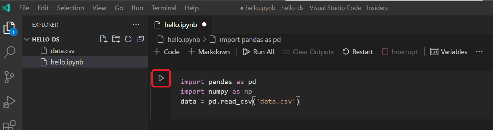

5. After the cell finishes running, you can view the data that was loaded using
   the Variables Explorer and Data Viewer. First select the **Variables** icon
   in the notebook's upper toolbar.

   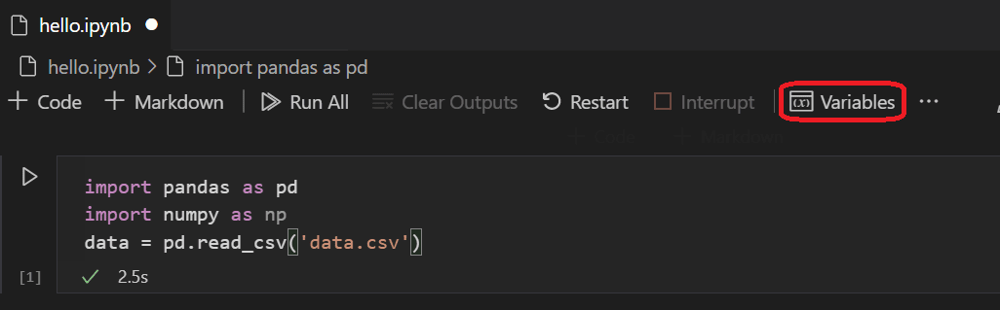

6. A **JUPYTER: VARIABLES** pane opens at the bottom of VS Code. It contains a
   list of the variables defined so far in your running kernel (`data` with
   shape `(1309, 14)`).

   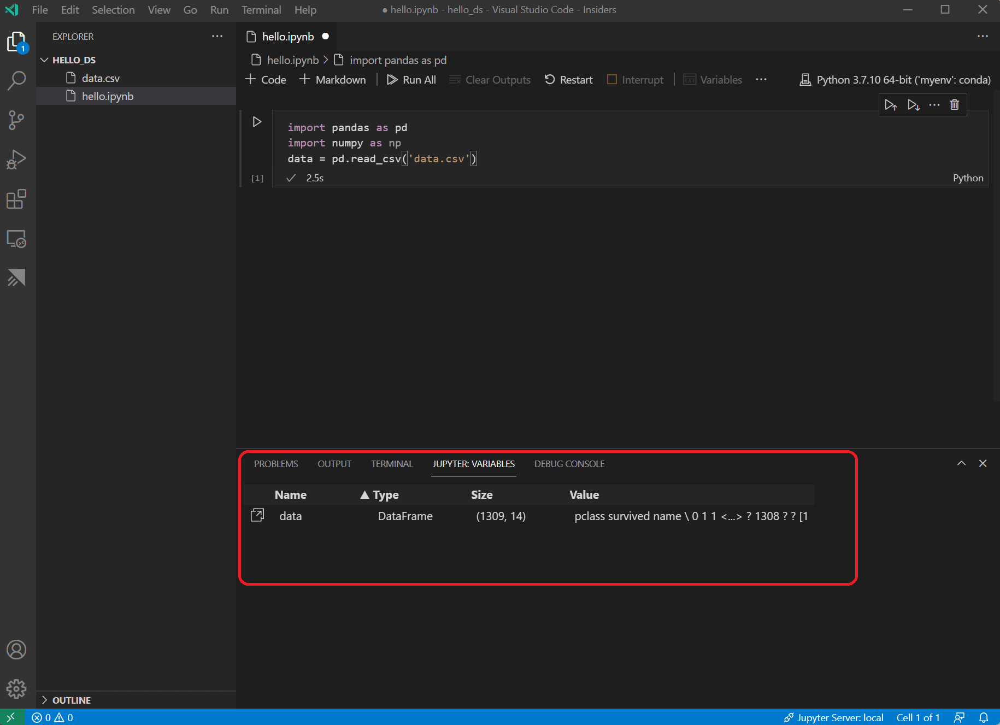

7. To view the data in the pandas DataFrame previously loaded, select the
   **Data Viewer** icon to the left of the `data` variable.

   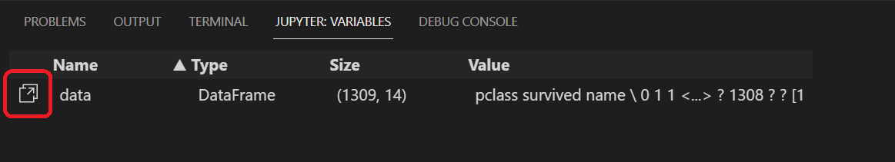

8. Use the Data Viewer to view, sort, and filter the rows of data. After
   reviewing the data, graphing key columns helps visualize the relationships
   between the different variables.

   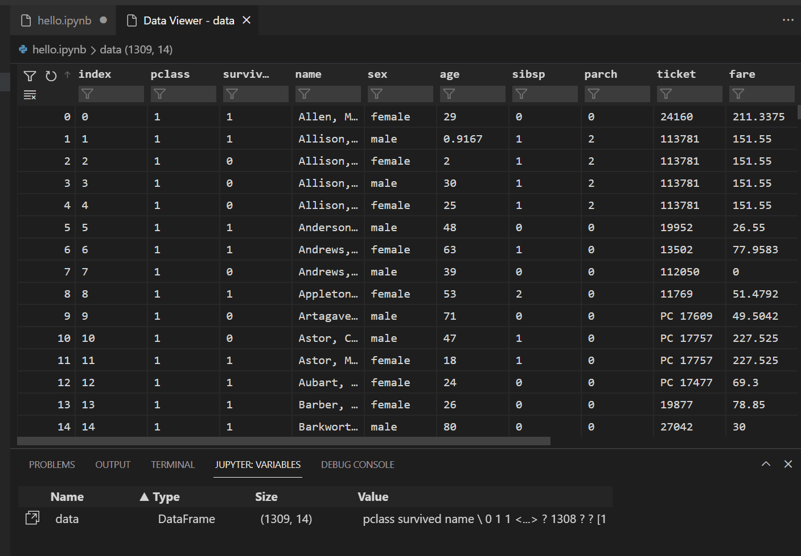

   Alternatively, you can use the data viewing experience offered by extensions
   such as [Data Wrangler](https://marketplace.visualstudio.com/items?itemName=ms-toolsai.datawrangler),
   which provides data profiling, quality checks, and transformations.

9. Before the data can be graphed, you need to make sure that there are not any
   formatting issues with it. If you inspect the Titanic CSV file, you will
   notice that a question mark (`"?"`) was used to identify cells where data
   was not available.

   While pandas can read this value into a DataFrame, the result for a column
   like **age** or **fare** is that its data type is set to **object** instead
   of a numeric data type, which is problematic for graphing and modeling.

   Correct this by replacing the question mark with the
   [numpy `NaN`](https://numpy.org/doc/stable/reference/constants.html#numpy.nan)
   missing-value marker that pandas understands, and cast the `age` and `fare`
   columns to `np.float64`. Add the following code to the next cell in your
   notebook and run it:

   > [!TIP]
   > To add a new cell, use the insert cell icon in the bottom-left corner of
   > an existing cell, or press `Esc` to enter command mode followed by the
   > `B` key.

   ```python
   data.replace('?', np.nan, inplace=True)
   data = data.astype({"age": np.float64, "fare": np.float64})
   ```

   > [!NOTE]
   > If you ever need to inspect the data type used for each column, check the
   > [DataFrame `dtypes`](https://pandas.pydata.org/pandas-docs/stable/reference/api/pandas.DataFrame.dtypes.html)
   > attribute (`data.dtypes`).

10. Now that the data is in clean numeric shape, use
    [seaborn](https://seaborn.pydata.org/) and
    [matplotlib](https://matplotlib.org/) to view how specific columns of the
    dataset relate to survivability. Add the following code to the next cell in
    your notebook and run it to see the generated five-panel figure:

    ```python
    import seaborn as sns
    import matplotlib.pyplot as plt

    fig, axs = plt.subplots(ncols=5, figsize=(30,5))
    sns.violinplot(x="survived", y="age", hue="sex", data=data, ax=axs[0])
    sns.pointplot(x="sibsp", y="survived", hue="sex", data=data, ax=axs[1])
    sns.pointplot(x="parch", y="survived", hue="sex", data=data, ax=axs[2])
    sns.pointplot(x="pclass", y="survived", hue="sex", data=data, ax=axs[3])
    sns.violinplot(x="survived", y="fare", hue="sex", data=data, ax=axs[4])
    ```

    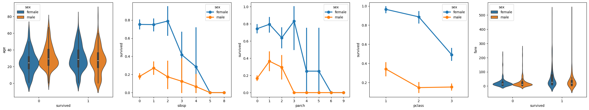

    > [!TIP]
    > To copy your graph quickly, hover over the upper-right corner of the
    > rendered plot and select the **Copy to Clipboard** button. You can also
    > inspect fine details of the chart by selecting the **Expand image**
    > button.

    

11. These graphs are helpful in seeing relationships between survival and the
    input variables of the data, and you can also use **pandas** to calculate
    numeric correlations. Because correlation requires numeric columns and
    `sex` is currently stored as strings (`'male'` and `'female'`), convert
    those string values to integers by adding and running the following cell:

    ```python
    data.replace({'male': 1, 'female': 0}, inplace=True)
    ```

12. Analyze the correlation between all the numeric input variables to identify
    the features that will be the best inputs to a machine learning model. The
    closer a value is to `1`, the stronger the linear correlation between that
    variable and `survived`. Run the following code in a new cell:

    ```python
    data.corr(numeric_only=True).abs()[["survived"]]
    ```

    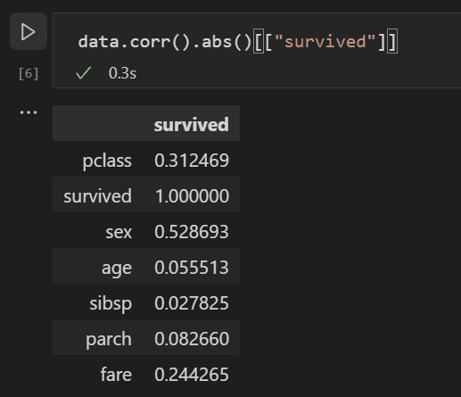

    Your output will match:

    ```text
              survived
    pclass    0.312469
    survived  1.000000
    sex       0.528693
    age       0.055512
    sibsp     0.027825
    parch     0.082660
    fare      0.244265
    body           NaN
    ```

13. Looking at the correlation results, you will notice that variables such as
    `sex` (`0.528693`), `pclass` (`0.312469`), and `fare` (`0.244265`) have a
    fairly high correlation to survival, while `sibsp` (siblings or spouse,
    `0.027825`) and `parch` (parents or children, `0.082660`) show very weak
    individual correlation.

    Let's hypothesize that `sibsp` and `parch` are related in how they affect
    survivability, and group them into a new binary column called `relatives`
    to see whether the combination of them has a higher correlation with
    survivability. For each passenger, check whether `sibsp + parch > 0`; if
    so, record `1` (the passenger had at least one relative on board), otherwise
    `0`.

    Add and run the following code cell to create the `relatives` column and
    recalculate the correlation table:

    ```python
    data['relatives'] = data.apply(lambda row: int((row['sibsp'] + row['parch']) > 0), axis=1)
    data.corr(numeric_only=True).abs()[["survived"]]
    ```

    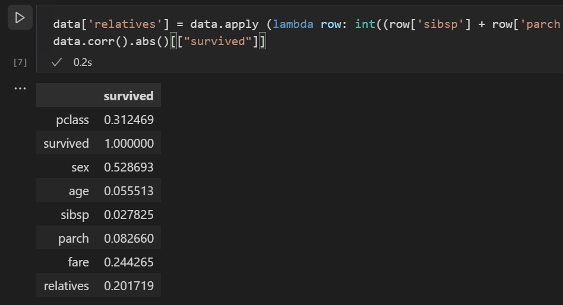

    ```text
               survived
    pclass     0.312469
    survived   1.000000
    sex        0.528693
    age        0.055512
    sibsp      0.027825
    parch      0.082660
    fare       0.244265
    body            NaN
    relatives  0.201719
    ```

14. Notice that when evaluated from the standpoint of *whether* a person had
    relatives (`0.201719`), versus *how many* relatives, there is a
    substantially higher correlation with survival. With this feature in hand,
    drop the lower-value `sibsp` and `parch` columns, keep the five selected
    features plus `survived`, and drop any rows that contain `NaN` values:

    ```python
    data = data[['sex', 'pclass', 'age', 'relatives', 'fare', 'survived']].dropna()
    ```

    > [!NOTE]
    > Although `age` had a low direct linear correlation (`0.055512`), it is
    > retained because it provides useful interaction signal in combination
    > with other inputs such as `pclass`, `relatives`, and `sex`.

## Part 2: Split and normalize the dataset for both models

Before training either model, divide the cleaned dataset (1,043 rows) into
training and test splits and standardize the feature scales so both **Model 1
(Gaussian Naive Bayes)** and **Model 2 (Keras Sequential Neural Network)** are
trained and evaluated on the exact same data.

1. A vital first step in supervised learning is splitting the dataset into
   training and validation/test data. If you used all your data to train a
   model, you would have no unbiased way to estimate how well it generalizes to
   unseen passengers. Add a Markdown heading `TRAIN and EVALUATE A MODEL` and
   run a code cell with `train_test_split` from `scikit-learn`:

   ```python
   from sklearn.model_selection import train_test_split
   x_train, x_test, y_train, y_test = train_test_split(
       data[['sex', 'pclass', 'age', 'relatives', 'fare']],
       data.survived,
       test_size=0.2,
       random_state=0,
   )
   ```

   With `test_size=0.2` and `random_state=0`, `x_train` contains 834 passengers
   and `x_test` contains 209 passengers.

2. Next, normalize the inputs so that all five features are treated on a
   comparable scale. Within the dataset, `age` ranges from roughly `0` to `80`
   and `fare` exceeds `500`, whereas `sex` and `relatives` are only `0` or `1`.
   Standardizing each feature to zero mean and unit variance is especially
   important for neural network gradient descent. Add and run the following
   code cell:

   ```python
   from sklearn.preprocessing import StandardScaler
   sc = StandardScaler()
   X_train = sc.fit_transform(x_train)
   X_test = sc.transform(x_test)
   ```

   > [!IMPORTANT]
   > Call `sc.fit_transform(x_train)` on the training split to learn the mean
   > and standard deviation from training data only, then call
   > `sc.transform(x_test)` on the test split so test-set statistics never leak
   > into training.

## Part 3: Try Model 1 — Train and evaluate a Gaussian Naive Bayes classifier (`scikit-learn`)

There are many machine learning algorithms to choose from for binary
classification. The `scikit-learn` library provides support for many of them,
along with a [machine learning algorithm cheat-sheet](https://scikit-learn.org/stable/tutorial/machine_learning_map/index.html)
to help select the right estimator for your scenario. For **Model 1**, you will
train a [Gaussian Naive Bayes (`GaussianNB`)](https://scikit-learn.org/stable/modules/naive_bayes.html)
classifier, a fast probabilistic algorithm that models each feature as a
class-conditional Gaussian distribution.

1. Add a code cell to instantiate and train the `GaussianNB` classifier on
   `(X_train, y_train)`:

   ```python
   from sklearn.naive_bayes import GaussianNB
   model = GaussianNB()
   model.fit(X_train, y_train)
   ```

2. With **Model 1** trained, evaluate it against the held-out test set
   (`X_test`, `y_test`) that was held back from training. Add and run the
   following cell to predict test outcomes and compute accuracy:

   ```python
   from sklearn import metrics
   predict_test = model.predict(X_test)
   print(metrics.accuracy_score(y_test, predict_test))
   ```

   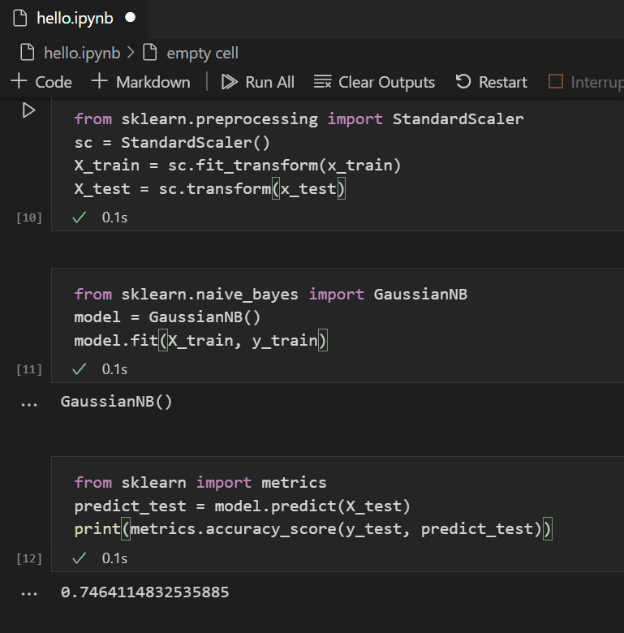

   The printed test accuracy is:

   ```text
   0.7464114832535885
   ```

   Looking at the test result, the Gaussian Naive Bayes classifier achieves an
   approximately **75% success rate** (`74.64%`) at estimating passenger
   survival.

3. Now create a detailed evaluation cell (matching `datascience-using-jupyter.ipynb`)
   that prints the **confusion matrix** and **classification report**
   (`precision`, `recall`, `f1-score`, and `support`) and renders a Seaborn
   heatmap of the confusion matrix for **Model 1**:

   ```python
   predict_test_binary = (predict_test.ravel() >= 0.5).astype(int)
   print(metrics.confusion_matrix(y_test, predict_test_binary))
   print(metrics.classification_report(y_test, predict_test_binary))

   # Visualize the confusion matrix for Model 1 (Gaussian Naive Bayes)
   import matplotlib.pyplot as plt
   import seaborn as sns

   plt.figure(figsize=(8, 6))
   sns.heatmap(metrics.confusion_matrix(y_test, predict_test_binary), annot=True, fmt='d', cmap='Blues')
   plt.xlabel('Predicted')
   plt.ylabel('Actual')
   plt.title('Confusion Matrix')
   plt.show()
   ```

   You will see the following classification report and confusion matrix
   heatmap:

   ```text
   [[106  22]
    [ 31  50]]
                 precision    recall  f1-score   support

              0       0.77      0.83      0.80       128
              1       0.69      0.62      0.65        81

       accuracy                           0.75       209
      macro avg       0.73      0.72      0.73       209
   weighted avg       0.74      0.75      0.74       209
   ```

   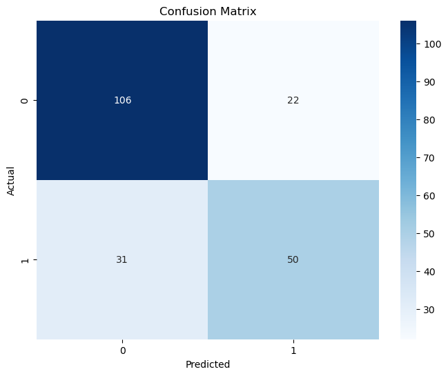

   * **True Negatives (`106`)**: passengers who did not survive and were
     correctly predicted as `0`.
   * **False Positives (`22`)**: passengers who did not survive but were
     incorrectly predicted as `1`.
   * **False Negatives (`31`)**: passengers who survived (`1`) but were missed
     by the model (`0`).
   * **True Positives (`50`)**: passengers who survived and were correctly
     predicted as `1`.

## Part 4: Try Model 2 — Build, train and evaluate a Sequential Neural Network (`Keras` and `TensorFlow`)

A neural network is a model that uses learned weights, biases, and non-linear
activation functions, inspired by biological neurons, to determine an outcome
from provided inputs. Unlike Gaussian Naive Bayes (which assumes features are
conditionally independent given the class), a multi-layer neural network can
learn non-linear feature interactions directly from data. In this section, you
use the [Keras](https://keras.io/) library with
[TensorFlow](https://www.tensorflow.org/) to construct **Model 2**, inspect its
untrained baseline, train it for 50 epochs, and compare its test performance
against **Model 1**.

1. Import `Sequential` and `Dense` from `keras` and instantiate a
   [Sequential](https://keras.io/guides/sequential_model/) neural network (a
   layered network in which each layer feeds into the next in sequence):

   ```python
   from keras.models import Sequential
   from keras.layers import Dense

   model = Sequential()
   ```

2. Add the three `Dense` layers of the neural network:

   ```python
   model.add(Dense(5, kernel_initializer='uniform', activation='relu', input_dim=5))
   model.add(Dense(5, kernel_initializer='uniform', activation='relu'))
   model.add(Dense(1, kernel_initializer='uniform', activation='sigmoid'))
   ```

   * **Layer 1 (`Dense(5, ..., input_dim=5, activation='relu')`)**: takes the 5
     standardized input features (`sex`, `pclass`, `age`, `relatives`, `fare`)
     and outputs 5 hidden activations using the Rectified Linear Unit (`relu`)
     activation function.
   * **Layer 2 (`Dense(5, ..., activation='relu')`)**: a second hidden layer of
     5 units with `relu` activation to capture combinations of features.
   * **Layer 3 (`Dense(1, ..., activation='sigmoid')`)**: outputs a single
     value scaled in the range `[0, 1]` via the `sigmoid` activation function,
     representing the predicted survival probability.

3. Inspect the architecture and trainable parameter count of **Model 2** by
   running `model.summary()` in the next code cell:

   ```python
   model.summary()
   ```

   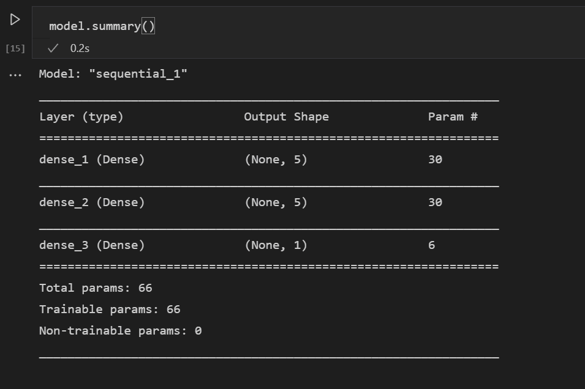

   The model has `30 + 30 + 6 = 66` trainable parameters (`5×5 + 5` in the
   first layer, `5×5 + 5` in the second layer, and `5×1 + 1` in the output
   layer).

4. **Check Model 2 before training (untrained random-weights baseline)**:
   In `datascience-using-jupyter.ipynb`, before running `model.fit(...)`, run
   the evaluation cell once on the freshly initialized network to see how
   untrained uniform weights perform on `X_test`:

   ```python
   from sklearn import metrics
   predict_test = model.predict(X_test)
   print(metrics.accuracy_score(y_test, (predict_test.ravel() >= 0.5).astype(int)))
   predict_test_binary = (predict_test.ravel() >= 0.5).astype(int)
   print(metrics.confusion_matrix(y_test, predict_test_binary))
   print(metrics.classification_report(y_test, predict_test_binary))

   import matplotlib.pyplot as plt
   import seaborn as sns

   plt.figure(figsize=(8, 6))
   sns.heatmap(metrics.confusion_matrix(y_test, predict_test_binary), annot=True, fmt='d', cmap='Blues')
   plt.xlabel('Predicted')
   plt.ylabel('Actual')
   plt.title('Confusion Matrix')
   plt.show()
   ```

   Because the weights have not been trained yet, accuracy is near random
   guessing (for example `0.4785` or `~48%` in the reference notebook):

   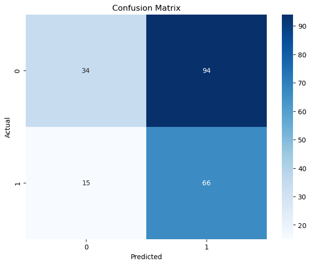

5. **Compile and train Model 2**:
   Once the neural network architecture is defined, compile it by specifying
   the optimizer (`adam`), the binary classification loss function
   (`binary_crossentropy`), and the metric to track (`accuracy`), then train it
   on `(X_train, y_train)` with `batch_size=32` for `50` epochs:

   > [!NOTE]
   > This step takes anywhere from a few seconds to a minute depending on your
   > machine. Watch the `loss` decrease and `accuracy` rise from ~61% in Epoch 1
   > toward ~79%–80% by Epoch 50.

   ```python
   model.compile(optimizer="adam", loss='binary_crossentropy', metrics=['accuracy'])
   model.fit(X_train, y_train, batch_size=32, epochs=50)
   ```

   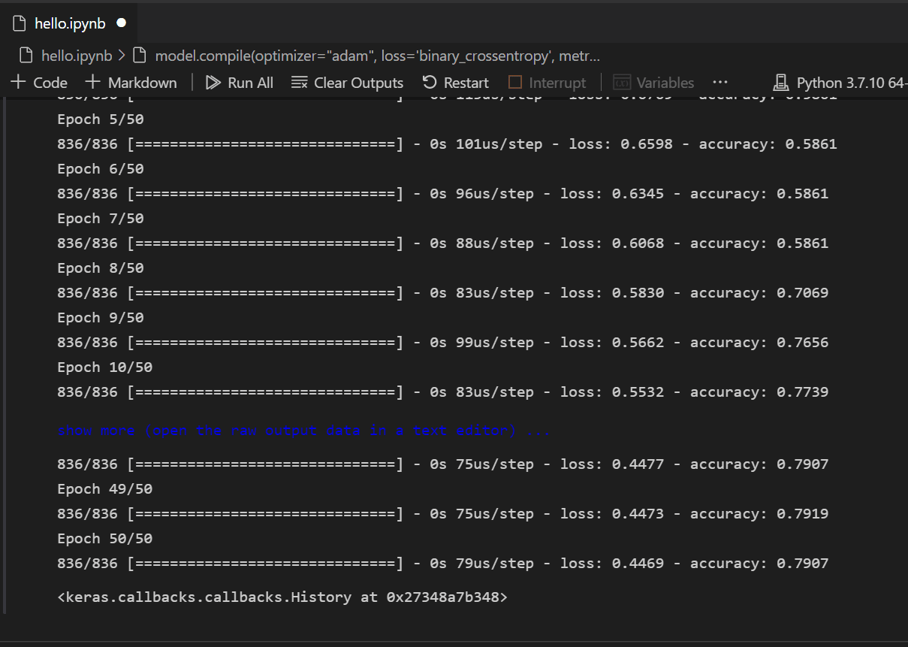

6. **Evaluate the trained Model 2 against the test data**:
   Now that the neural network is trained, evaluate it on the held-out test set
   (`X_test`, `y_test`). Following `datascience-using-jupyter.ipynb`, compute
   the test accuracy, full `classification_report`, and `log_loss`:

   ```python
   y_pred = np.rint(model.predict(X_test).flatten())
   print(metrics.accuracy_score(y_test, y_pred))
   print(metrics.classification_report(y_test, y_pred))
   print(metrics.log_loss(y_test, y_pred))
   ```

   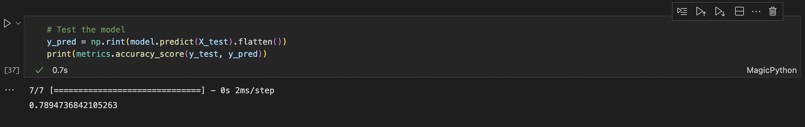

   In the reference run of `datascience-using-jupyter.ipynb`, the trained
   neural network outputs:

   ```text
   0.8038277511961722
                 precision    recall  f1-score   support

              0       0.81      0.88      0.85       128
              1       0.79      0.68      0.73        81

       accuracy                           0.80       209
      macro avg       0.80      0.78      0.79       209
   weighted avg       0.80      0.80      0.80       209

   3.1274536425607193
   ```

   > [!TIP]
   > Because neural network weight initialization and stochastic mini-batch
   > updates have slight randomness, your exact accuracy after 50 epochs will
   > typically land between **79% and 81%** (`0.789` to `0.809`), consistently
   > outperforming the **74.6%** (`0.7464`) accuracy of **Model 1 (`GaussianNB`)**.

7. You can also plot the confusion matrix heatmap for the **trained** neural
   network (`y_pred`) to compare it visually with **Model 1**:

   ```python
   plt.figure(figsize=(8, 6))
   sns.heatmap(metrics.confusion_matrix(y_test, y_pred), annot=True, fmt='d', cmap='Blues')
   plt.xlabel('Predicted')
   plt.ylabel('Actual')
   plt.title('Confusion Matrix (Trained Keras Neural Network)')
   plt.show()
   ```

   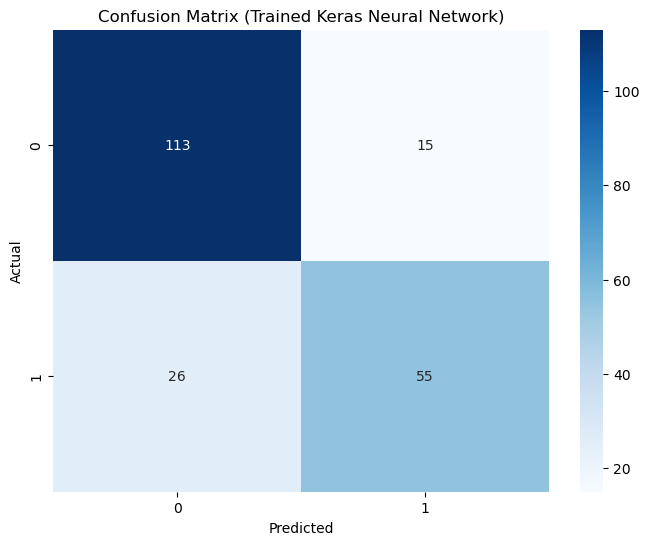

## Part 5: Compare the two models and explore inline metric tutorials

### Side-by-side comparison of Model 1 (`GaussianNB`) and Model 2 (`Sequential` Neural Network)

Review how the two models performed on the exact same 209 held-out passengers
(`X_test`, `y_test`):

| Metric / Characteristic            | Model 1: `scikit-learn` `GaussianNB` | Model 2: `Keras` / `TensorFlow` `Sequential` NN |
|------------------------------------|--------------------------------------|-------------------------------------------------|
| **Library**                        | `sklearn.naive_bayes.GaussianNB`     | `keras.models.Sequential` (`Dense` 5-5-1)       |
| **Test Accuracy**                  | `0.7464` (**74.6%**)                 | `0.8038` (**80.4%**, typically **79%–80%**)     |
| **Class 0 (Did not survive) P/R/F1** | Precision `0.77`, Recall `0.83`, F1 `0.80` | Precision `0.81`, Recall `0.88`, F1 `0.85` |
| **Class 1 (Survived) P/R/F1**      | Precision `0.69`, Recall `0.62`, F1 `0.65` | Precision `0.79`, Recall `0.68`, F1 `0.73` |
| **True Negatives / False Positives** | `106` TN / `22` FP                 | `113` TN / `15` FP                              |
| **False Negatives / True Positives** | `31` FN / `50` TP                  | `26` FN / `55` TP                               |
| **Training Time**                  | Milliseconds (closed-form fit)       | A few seconds (50 epochs × 27 batches)          |
| **Determinism**                    | Deterministic on fixed split         | Stochastic (depends on weight init & batches)   |
| **Feature Interaction Modeling**   | Assumes conditional independence     | Learns non-linear interactions via `relu` layers |

### Try both models on custom passenger profiles

To see both models in action side by side, re-instantiate or keep separate
variable names (`gnb_model` and `nn_model`) and test them on two synthetic
passengers—for example, a 25-year-old female in 1st class traveling with a
relative (`fare=100`), and a 35-year-old male in 3rd class traveling alone
(`fare=8.05`):

```python
import pandas as pd
from sklearn.naive_bayes import GaussianNB

# Keep a named reference to Model 1 alongside the trained Keras model (Model 2)
gnb_model = GaussianNB()
gnb_model.fit(X_train, y_train)

sample_passengers = pd.DataFrame([
    {"sex": 0, "pclass": 1, "age": 25.0, "relatives": 1, "fare": 100.0},  # Passenger A: 1st-class female with relative
    {"sex": 1, "pclass": 3, "age": 35.0, "relatives": 0, "fare": 8.05},   # Passenger B: 3rd-class male traveling alone
])

sample_scaled = sc.transform(sample_passengers)

gnb_probs = gnb_model.predict_proba(sample_scaled)[:, 1]
gnb_preds = gnb_model.predict(sample_scaled)

nn_probs = model.predict(sample_scaled).flatten()
nn_preds = np.rint(nn_probs).astype(int)

for idx, label in enumerate(["Passenger A (1st-class female)", "Passenger B (3rd-class male)"]):
    print(
        f"{label}:\n"
        f"  Model 1 (GaussianNB) -> survival prob={gnb_probs[idx]:.3f}, predicted={gnb_preds[idx]}\n"
        f"  Model 2 (Keras NN)   -> survival prob={nn_probs[idx]:.3f}, predicted={nn_preds[idx]}"
    )
```

### Render interactive HTML metric tutorials inside the notebook

The final cells of `datascience-using-jupyter.ipynb` link and embed the three
plain-English visual tutorials from Module 02 (`04-GAIS-Lab-BigQuery-ML`) so
you can review confusion matrices, precision/recall/F1, log loss, and training
loss curves directly inside your Jupyter notebook:

1. Add a Markdown cell listing the three metric tutorials:

   * Confusion matrix, Precision-Recall, and ROC curves:
     [confusion-matrix-pr-roc-tutorial.html](../../02-Google-AI-Studio/04-GAIS-Lab-BigQuery-ML/confusion-matrix-pr-roc-tutorial.html)
   * Evaluation metrics (`precision`, `recall`, `accuracy`, `f1_score`,
     `log_loss`, `roc_auc`):
     [evaluation-metrics-tutorial.html](../../02-Google-AI-Studio/04-GAIS-Lab-BigQuery-ML/evaluation-metrics-tutorial.html)
   * Training metrics and loss curves across iterations/epochs:
     [training-metrics-tutorial.html](../../02-Google-AI-Studio/04-GAIS-Lab-BigQuery-ML/training-metrics-tutorial.html)

2. Add and run the following code cell to render the **Confusion Matrix, PR &
   ROC Curve Tutorial** inline in your notebook:

   ```python
   from html import escape
   import re
   from urllib.request import urlopen
   from IPython.display import HTML, display

   url = (
       "https://raw.githubusercontent.com/ShahabName/"
       "applied-ai-training-labs/main/labs/student/"
       "02-Google-AI-Studio/04-GAIS-Lab-BigQuery-ML/"
       "confusion-matrix-pr-roc-tutorial.html"
   )

   with urlopen(url) as response:
       page = response.read().decode("utf-8")

   # Resolve the tutorial's relative image paths against its GitHub location.
   base_url = url.rsplit("/", 1)[0] + "/"
   page, count = re.subn(
       r"(<head\b[^>]*>)",
       lambda match: match.group(1) + f'<base href="{escape(base_url, quote=True)}">',
       page,
       count=1,
       flags=re.IGNORECASE,
   )
   if count != 1:
       raise ValueError("The HTML page does not contain a <head> element.")

   display(HTML(
       f'<iframe srcdoc="{escape(page, quote=True)}" '
       'width="100%" height="900" sandbox '
       'style="border: 1px solid #ccc;"></iframe>'
   ))
   ```

3. Add and run the final code cell to render the **Evaluation Metrics Tutorial**
   inline in your notebook:

   ```python
   from html import escape
   import re
   from urllib.request import urlopen
   from IPython.display import HTML, display

   url = (
       "https://raw.githubusercontent.com/ShahabName/"
       "applied-ai-training-labs/main/labs/student/"
       "02-Google-AI-Studio/04-GAIS-Lab-BigQuery-ML/"
       "evaluation-metrics-tutorial.html"
   )

   with urlopen(url) as response:
       page = response.read().decode("utf-8")

   # Resolve the tutorial's relative image paths against its GitHub location.
   base_url = url.rsplit("/", 1)[0] + "/"
   page, count = re.subn(
       r"(<head\b[^>]*>)",
       lambda match: match.group(1) + f'<base href="{escape(base_url, quote=True)}">',
       page,
       count=1,
       flags=re.IGNORECASE,
   )
   if count != 1:
       raise ValueError("The HTML page does not contain a <head> element.")

   display(HTML(
       f'<iframe srcdoc="{escape(page, quote=True)}" '
       'width="100%" height="900" sandbox '
       'style="border: 1px solid #ccc;"></iframe>'
   ))
   ```

## Troubleshooting

* **`FileNotFoundError: [Errno 2] No such file or directory: 'titanic3.csv'`**:
  ensure `titanic3.csv` is saved in the same folder (`hello_ds`) as
  `datascience-using-jupyter.ipynb`.
* **`ValueError: could not convert string to float: '?'`**: run the cleanup
  cell (`data.replace('?', np.nan, inplace=True)` and
  `data = data.astype({"age": np.float64, "fare": np.float64})`) before
  plotting or calculating correlations.
* **`FutureWarning: Downcasting behavior in replace is deprecated`**: this
  pandas informational warning on `data.replace({'male': 1, 'female': 0}, inplace=True)`
  is expected on newer pandas versions and does not prevent the correlation or
  training cells from succeeding.
* **`UserWarning: Do not pass an input_shape/input_dim argument to a layer`**:
  Keras 3 prints this informational warning when `input_dim=5` is passed to
  `Dense(...)`; the model builds and trains normally.
* **`ModuleNotFoundError: No module named 'keras'` or `'tensorflow'`**: check
  the top-right kernel picker in VS Code and select your `myenv` (or `.venv`)
  environment created in `00-DSJN-Lab-Setup`.

## Summary

In this exercise, you loaded and cleaned the Titanic dataset in a VS Code
Jupyter notebook, inspected variables in the Data Viewer, visualized survival
relationships with Seaborn, engineered the `relatives` feature using
correlation analysis, and trained, evaluated, and compared two models: a
`scikit-learn` **Gaussian Naive Bayes** classifier (~75% accuracy) and a
`Keras`/`TensorFlow` **Sequential Neural Network** (~80% accuracy).

## Clean up

Nothing in this lab is billable. Save `datascience-using-jupyter.ipynb` with
all cell outputs visible, verify with `git status` that `.venv/` and any cache
folders are ignored, and commit `hello_ds/datascience-using-jupyter.ipynb`,
`hello_ds/titanic3.csv`, and a short summary comparing the two models to your
separate portfolio repository.

### End the lab

Close the Data Viewer tabs and shut down or restart the notebook kernel when
finished.

### Next steps

Now that you are familiar with performing data science and comparing classical
and neural models within Visual Studio Code, explore these additional
resources:

* [Data Science profile template](https://code.visualstudio.com/docs/configure/profiles#_data-science-profile-template) — create a VS Code profile with a curated set of extensions, settings, and snippets.
* [Jupyter Notebooks in Visual Studio Code](https://code.visualstudio.com/docs/datascience/jupyter-notebooks) — learn more about interactive notebook features.
* [Get started with Azure Machine Learning for VS Code](https://learn.microsoft.com/azure/machine-learning/how-to-setup-vs-code) — deploy and optimize models using Azure.

### How this lab was tested

On 2026-11-06 all cells of `datascience-using-jupyter.ipynb` were executed on
Windows 11 in Visual Studio Code using a Miniconda environment with `pandas`,
`numpy`, `seaborn`, `matplotlib`, `scikit-learn`, `keras`, and `tensorflow`.
`GaussianNB` achieved `0.7464` test accuracy (`[[106, 22], [31, 50]]`) and the
50-epoch Keras `Sequential` neural network achieved `0.8038` test accuracy on
the 209-row held-out test split.
