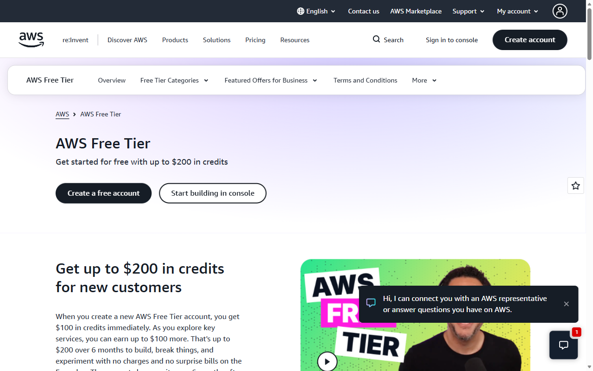
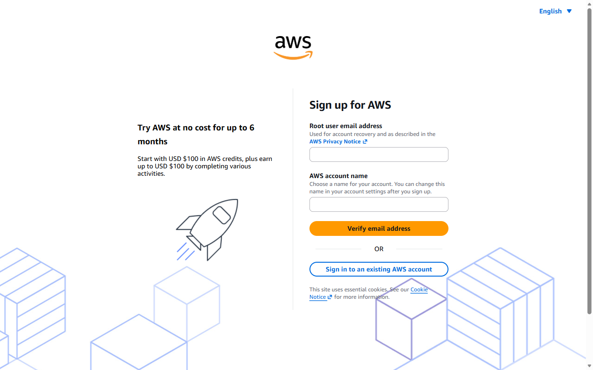

## Start here

[All student labs](../../../../README.md) |
[00-setup-lab](../../00-setup-lab/README.md) |
[Next: 01-AWS-Lab-bedrock](../01-AWS-Lab-bedrock/README.md)

This provider-specific setup adapts the general setup lab's safe GitHub,
conditional cloud access, evidence and cleanup requirements. It does not require
a model call or a paid upgrade. Complete account verification yourself in
standalone Microsoft Edge; never send passwords, verification codes, payment
details or credentials to the trainer or an AI assistant.

## Prerequisites

* Complete the offline check in 00-setup-lab.
* Use a separate work/submission repository, not this distribution repository.
* Have an email address, phone and any identity-verification information AWS
  requires. Only the account owner may provide these to AWS.
* Check [AWS account plans](https://docs.aws.amazon.com/awsaccountbilling/latest/aboutv2/free-tier-plans.html)
  and [credit terms](https://aws.amazon.com/free/terms/) for your actual eligibility.

Cloud ineligibility is not a penalty. If access requires an unapproved paid plan,
stop and record access as pending or offline.

## Create or verify one AWS account

1. Open [AWS Free Tier](https://aws.amazon.com/free/) in standalone Edge. Reuse
   your existing course account rather than registering a second account.
2. For an eligible new account, choose the qualifying standalone Free Plan and
   Basic support when offered. Complete email, phone and identity verification
   privately in the browser.
3. Verify your actual plan, remaining credits and expiry in Billing and Cost
   Management. Offers are conditional, not guaranteed funding.
4. Do not upgrade to Paid, join an Organization or enable auto-upgrade programs
   to work around access restrictions. If your signup screen differs, stop and
   consult the trainer.

## Secure the account

1. Use root only for account administration. Open Security credentials and assign
   MFA, following the console instructions privately.
2. Never create root access keys or save credentials in your portfolio.
3. Before daily service work, arrange a trainer-approved non-root identity with
   temporary credentials. Do not create an Organization or grant broad
   administrator permissions solely to complete this lab.
4. Check that your work repository ignores `.env`, `.env.*`, `.venv/`, private
   keys and credential files. Reuse the general setup lab's ignore rules.

## Configure billing alerts and the next-lab boundary

1. Open [AWS Budgets](https://console.aws.amazon.com/billing/). Create a zero-spend
   alert or review an existing one and confirm its notification subscription.
2. Following the general setup checklist, configure an illustrative USD 1
   gross-cost budget with actual alerts at USD 0.50, USD 0.80 and USD 1.00.
   Exclude credits from gross-cost monitoring; inspect remaining credits
   separately. Do not duplicate budgets that already implement this policy.
3. Explain in your evidence that alerts may be delayed and do not cap spending.
4. Record the approved next-lab region, normally `us-east-1`, and the allowed
   Amazon Nova model. Availability in public documentation does not establish
   access in your account.
5. Do not invoke a model, launch EC2/RDS, subscribe to Marketplace models or
   create a Knowledge Base during setup.

## Readiness checkpoint

In your work repository, record a sanitized checklist:

| Check | Record |
| --- | --- |
| Local readiness | Passed or blocker |
| Account eligibility | Eligible, pending or offline |
| Plan and credit review | Reviewed, without identifiers |
| MFA and non-root service identity | Ready or pending |
| Budget notifications | Confirmed or pending |
| Region/model boundary | Trainer-approved or pending |

Do not include account numbers, billing screenshots with identity details,
tokens, card details or environment dumps. A pending service identity blocks
live service use, not offline completion.

## Troubleshooting and cleanup

* Pending activation: wait or contact AWS support; do not create another account.
* Model access unavailable: record the limitation; do not upgrade or broaden
  permissions without approval.
* No budget notification: check the recipient and subscription confirmation.

No service resource is required. Sign out when finished; keep MFA and alerts.
Do not delete shared identities or billing accounts. If you independently
created task-owned resources, review and remove them under the trainer's
approved cleanup procedure and inspect billing.

## Official sources and validation limits

This checklist is based on the course setup instructions, not a newly executed
AWS account test. Confirm current provider terms before use.

* [AWS signup](https://docs.aws.amazon.com/accounts/latest/reference/getting-started.html)
* [AWS Budgets](https://docs.aws.amazon.com/cost-management/latest/userguide/budgets-managing-costs.html)
* [Bedrock model access](https://docs.aws.amazon.com/bedrock/latest/userguide/model-access.html)
* [Bedrock pricing](https://aws.amazon.com/bedrock/pricing/)
