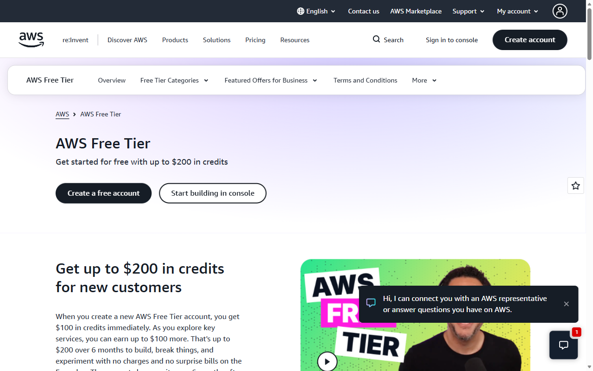
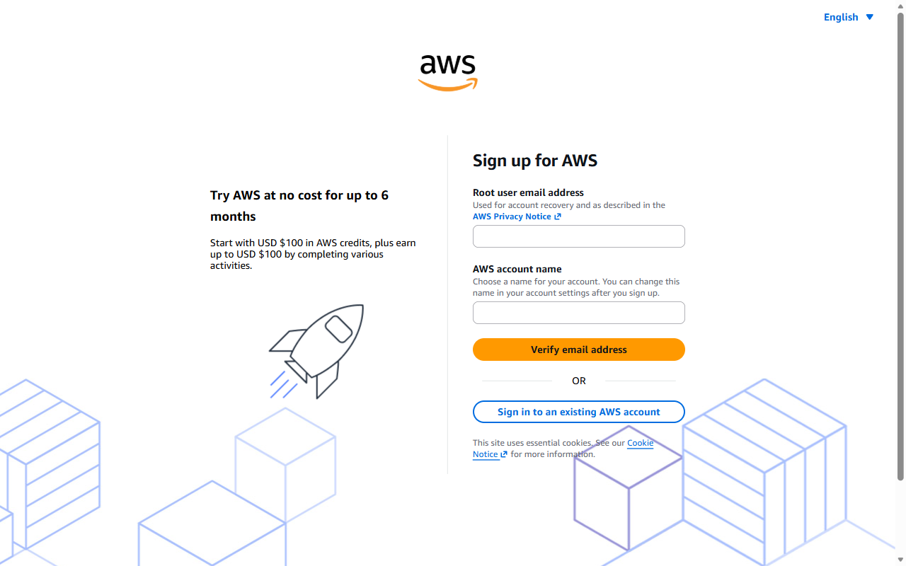

[All student labs](../../../../README.md) |
[AWS setup](../00-AWS-Lab-Setup-AWS/README.md) |
[Prerequisite: Google Lab 1](../../Google-AI-Studio/01-GAIS-Lab-JSON-Schema/README.md) |
[Continue: 02-GAIS-Lab-RAG-Python](../../Google-AI-Studio/02-GAIS-Lab-RAG-Python/README.md)

Complete the steps in your separate portfolio repository. Google Lab 1 provides
the prompts, JSON schema and comparison table used here. Check current AWS
eligibility and pricing; budget alerts do not stop spending. Never publish
account details. Source testing notes below are historical, not a new live-cloud
validation.

Complete AWS setup first. If your account, MFA and budgets are already ready,
verify them instead of repeating signup. Use a trainer-approved non-root
temporary identity for playground work; root is for account administration.

## Lab Overview

| Field | Details |
| --- | --- |
| Lab type | Hands-on lab |
| Course slide | Slide 91 · Week 1, Session 3 · Sat 26 Sep 2026 |
| Expected duration | 45 to 60 minutes |
| Environment | AWS Management Console in a web browser |
| Account and cost | AWS Free plan: USD 100 credit at sign-up, up to USD 100 more from onboarding activities, six months |
| Related labs | Google Lab 1 (same prompts in Gemini); Skillable Lab 03 (same prompts in Foundry) |
| Public docs | [AWS Free Tier](https://aws.amazon.com/free/) · [Free and paid account plans](https://docs.aws.amazon.com/awsaccountbilling/latest/aboutv2/free-tier-plans.html) · [Bedrock playgrounds](https://docs.aws.amazon.com/bedrock/latest/userguide/playgrounds.html) |
| Tested | 2026-10-09 · see the note at the end of the lab |

## Before you start

In this lab you create the AWS account that you will use in **all six AWS labs**. Have ready:

* An email address you control. It becomes the **root user** of the account.
* A mobile phone for SMS or voice verification.
* A credit or debit card. AWS uses it to verify your identity; on the Free plan you are not charged unless you upgrade.
* A password manager or another safe place for the root password.

Values that you type or select are shown like this: example. AWS console screens change from time to time; if a button has a slightly different name, look for the closest match.

When you are ready, continue below to start the exercise.

## Free plan account, budget alert and Bedrock playground

In this exercise, you create an AWS account on the **Free plan**, secure it with MFA, create a budget alert, and use the Amazon Bedrock playground to rerun the Week 1 prompts. Two of these steps (the budget and the Bedrock playground) also earn onboarding credits. You add the results to the Week 1 model comparison table.

This exercise takes approximately **45** minutes.

## Create an AWS account on the Free plan

1. In a web browser, open <https://aws.amazon.com/free/> at `https://aws.amazon.com/free/` and select **Create a free account**.

   
2. On the **Sign up for AWS** page, enter your **Root user email address** and an **AWS account name**, for example yourname-ai-course. Select **Verify email address**.

   
3. Enter the verification code from the email AWS sends you. Then create a strong root password and store it in your password manager.
4. Enter your contact information and choose Personal as the account type.
5. When you are asked to choose an account plan, select the **Free plan**. Know what it means:

   * USD 100 in credits at sign-up, and up to USD 100 more for completing five onboarding activities: launch an EC2 instance, use a model in the Amazon Bedrock playground, set up a cost budget with AWS Budgets, create a web app with AWS Lambda, and create an Amazon RDS database.
   * The Free plan ends after six months or when the credits are used, whichever comes first. The account then closes; AWS keeps your content for 90 days, during which you can upgrade to a paid plan.
   * The Free plan blocks services that could use up credits very quickly, so you cannot run up a large bill by accident.
6. Enter your card details for identity verification. A small temporary authorization can appear on your statement; it is released.
7. Verify your phone number by SMS or voice call, then choose the **Basic support** plan (free) and complete the sign-up.
8. Sign in to the console at <https://console.aws.amazon.com> at `https://console.aws.amazon.com` as the root user. Activation is usually quick; if a service says your account is not activated yet, wait a few minutes and try again. Do not create a second account.

## Secure the account

1. Select your account name at the top right of the console, then **Security credentials**. Under **Multi-factor authentication (MFA)**, select **Assign MFA device**, choose **Authenticator app**, scan the QR code with an authenticator app on your phone and enter two consecutive codes.
2. Never create access keys for the root user. Later labs use AWS CloudShell, which runs with your signed-in identity, so you do not need keys on your laptop.

   > **Tip**: For daily work, companies create a separate administrator user with IAM Identity Center and keep the root user for account tasks only. You may do the same; it is optional for this course.

## Create a budget alert

1. In the search bar at the top of the console, type Budgets and select **Budgets** (Billing and Cost Management). Select **Create budget**.
2. Under **Budget setup**, choose **Use a template (simplified)**, then the **Zero spend budget** template. It notifies you as soon as spending goes above zero.
3. Enter your email address as the recipient and select **Create budget**. Confirm the subscription email that AWS sends you.
4. Optional: create a second budget with the **Monthly cost budget** template, for example 10 USD, to warn you before you reach that amount.

   > A budget **sends alerts; it does not stop spending**. Your real protection is deleting resources at the end of every lab.
5. Return to the console home page and open the **Explore AWS** panel. It shows your credit balance and which onboarding activities you have completed. Open [Billing and Cost Management](https://console.aws.amazon.com/billing/) and check **Bills** and **Credits**.

## Choose a Region

1. In the Region selector at the top right, choose **US East (N. Virginia) us-east-1**. It offers the widest choice of Bedrock models. If a model or feature seems missing in a later lab, check the Region first.

## Rerun the Week 1 prompts in the Bedrock playground

1. In the console search bar, type Bedrock and open **Amazon Bedrock**. In the left menu, select **Playgrounds** and then **Chat** (or **Text**).
2. Select **Select model** and choose an **Amazon Nova** model, for example Nova Lite.

   > **Note**: Many models are enabled by default; third-party models are subscribed through AWS Marketplace the first time you use them. Anthropic models also need a one-time First Time Use form, so pick an Amazon model for this lab.
3. In the configuration panel, set **Temperature** to 0 (more repeatable answers for classification) and keep a modest maximum length.
4. Paste each Week 1 prompt (the same text as Google Lab 1) and run it. After each response, read the metrics the playground shows, such as latency and input and output tokens.

   **zero-shot**

   ```text
   Classify this hotel review as positive, neutral or negative. Reply with one word.
   Review: The room was clean but the Wi-Fi kept dropping all evening.
   ```

   **few-shot**

   ```text
   Classify each hotel review as positive, neutral or negative. Reply with one word.
   Review: Friendly staff and a great view of the Creek. Label: positive
   Review: The pool was closed and nobody told us. Label: negative
   Review: Average breakfast, convenient location. Label: neutral
   Review: Check-in was quick but the room smelled of smoke. Label:
   ```

   **reasoning**

   ```text
   Read the hotel review. First list the evidence for each possible label (positive, neutral, negative). Then give the final answer on the last line as 'Label: <label>'.
   Review: Beautiful lobby, but we waited 40 minutes for our room and the AC was noisy.
   ```

   **arabic**

   ```text
   Classify this hotel review as positive, neutral or negative. Reply with one word.
   Review: الموقع ممتاز والغرفة واسعة، لكن الإفطار كان بارداً.
   ```
5. If your playground offers a compare mode, run two models side by side on the same prompt.
6. Ask for JSON: paste the prompt below, then copy only the JSON from the answer into a file named `bedrock_review.json` in your `week1/gemini` folder.

   ```text
   Analyze this hotel review and reply with JSON only, with exactly these fields: "sentiment" (positive, neutral or negative), "topics" (list of strings), "language" ("ar" or "en") and "needs_follow_up" (true or false).
   Review: The room was spotless but check-in took 40 minutes and nobody apologised.
   ```
7. Validate it with the same schema you used for Gemini. Create `validate_json.py` in `week1/gemini`, then run `python validate_json.py bedrock_review.json`:

   ```python
   """Validate JSON copied from the Bedrock playground against the Review schema from Google Lab 1."""
   import sys
   from typing import Literal

   from pydantic import BaseModel, Field, ValidationError


   class Review(BaseModel):
       sentiment: Literal["positive", "neutral", "negative"]
       topics: list[str] = Field(description="Aspects mentioned, for example staff, cleanliness, location, price")
       language: Literal["ar", "en"]
       needs_follow_up: bool = Field(description="True if the guest reports a problem the hotel should act on")


   with open(sys.argv[1], encoding="utf-8") as f:
       text = f.read()
   try:
       print("valid:", Review.model_validate_json(text))
   except ValidationError as err:
       print("INVALID:", err)
   ```

   A valid answer prints `valid: sentiment='negative' ...`. Without a response schema, models sometimes add text around the JSON or invent field values; record what you see.

## Record results and check billing

1. Add one row per prompt to `week1/model_comparison.csv`: aws-bedrock, the model ID, the prompt ID, `correct`, the latency in seconds, `valid_json`, and a note with the token counts and the Region.
2. Open [Billing and Cost Management](https://console.aws.amazon.com/billing/) and check **Bills** and **Credits**. A few playground prompts cost very little and are covered by your credits.

## Troubleshooting

* "You don't have access to the model": choose another model, check the Region, or complete the Anthropic form if you chose an Anthropic model.
* Marketplace subscription errors on first use: wait a few minutes and retry.
* Account still pending: activation can take longer for some cards. Wait; do not open a second account.
* No budget email: confirm the subscription email from AWS Notifications.

## Summary

You created and secured an AWS Free plan account, set a zero-spend budget alert, and compared Bedrock models on the Week 1 prompts, including JSON validation.

## Clean up

The playground creates no resources. If you launched anything else for an onboarding activity, such as an EC2 instance, stop and terminate it now.

### End the lab

Commit the updated comparison table and a screenshot of your budget with no account number or card details visible.

### How this lab was tested

On 2026-10-09 the AWS Free Tier and sign-up pages were captured as shown, and `validate_json.py` was run with valid and invalid samples. Console pages after sign-in are described, not shown, so that no account details appear.
