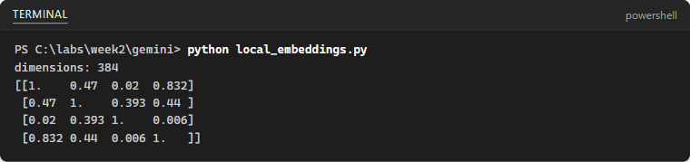

[All student labs](../../../README.md) |
[Prerequisite: Google Lab 1](../google-lab-01-json-schema/README.md) |
[Prerequisite: Python Lab 1](../python-lab-01-cited-rag/README.md)

Complete the steps in your separate portfolio repository. Reuse the documents,
evaluation set and environment from Python Lab 1 and the key from Google Lab 1.
Check current provider pricing and eligibility. Delete your File Search store
after recording results. Source testing notes below are historical, not a new
live-cloud validation.

## Lab Overview

| Field | Details |
| --- | --- |
| Lab type | Hands-on lab |
| Course slide | Slide 141 · Week 2, Session 3 · Mon 5 Oct 2026 |
| Expected duration | 45 minutes |
| Environment | Your laptop: the Python Lab 1 project folder and virtual environment |
| Account and cost | Gemini API free tier (File Search store up to 1 GB on the free tier) |
| Related labs | Python Lab 1 (your own pipeline); AWS Lab 2 (Bedrock Knowledge Bases) |
| Public docs | [Embeddings](https://ai.google.dev/gemini-api/docs/embeddings) · [File Search](https://ai.google.dev/gemini-api/docs/file-search) |
| Tested | 2026-10-09 · see the note at the end of the lab |

## Before you start

You need one personal Google account (Gmail) for all four Google labs. You must be 18 or older. The United Arab Emirates is a supported country for Google AI Studio and the Gemini API ([available regions](https://ai.google.dev/gemini-api/docs/available-regions)). Turn off any VPN.

* The Gemini API free tier needs **no payment method**. Rate limits apply per project; you can see them in Google AI Studio.
* Content you send on the free tier may be used to improve Google products. Use only public, synthetic or non-sensitive data, never personal data.
* Keep your API key in a `.env` file that is listed in `.gitignore`. Never paste a key into code, chats, screenshots or commits.

Values that you type or select are shown like this: example. Replace anything in angle brackets, such as `<your key>`, with your own value.

You also need the `data` folder and `eval.csv` from Python Lab 1: the public UAE AI Charter text and the two AI ethics guideline PDFs.

When you are ready, continue below to start the exercise.

## Gemini embeddings and File Search

In this exercise, you compare sentence meanings with a local embedding model and with Gemini embeddings, then use the Gemini API **File Search** tool, which chunks, embeds, stores and retrieves your documents for you. You ask the same evaluation questions as in Python Lab 1 and compare answers, citations and effort.

This exercise takes approximately **45** minutes.

## Set up

1. Create the folder `week2/gemini` in your repository and copy the `data` folder and `eval.csv` from `week2/rag` into it. Open a terminal in `week2/gemini`.

   ```powershell
   Copy-Item ..\rag\data .\data -Recurse
   Copy-Item ..\rag\eval.csv .
   ```
2. Activate the Python Lab 1 virtual environment (it already has the local embedding model) and add the Gemini SDK. Create the `.env` file with your key:

   ```powershell
   ..\rag\.venv\Scripts\Activate.ps1
   pip install -U google-genai python-dotenv
   Set-Content .env "GEMINI_API_KEY=<your key>"
   Set-Content .gitignore ".env"
   ```

## Compare meanings with embeddings

An embedding is a list of numbers. Texts with similar meaning get vectors that point in similar directions, so their cosine similarity is close to 1.

1. Create `local_embeddings.py` to test the local model you used in Python Lab 1:

   ```python
   """The same similarity test with the local model from Python Lab 1 (no key needed)."""
   import numpy as np
   from sentence_transformers import SentenceTransformer

   TEXTS = [
       "How do I renew my residence visa?",
       "Steps to extend an Emirates residency permit",
       "Best beaches in Dubai",
       "كيف أجدد تأشيرة الإقامة؟",  # Arabic: "How do I renew my residence visa?"
   ]

   model = SentenceTransformer("sentence-transformers/paraphrase-multilingual-MiniLM-L12-v2")
   vectors = model.encode(TEXTS, normalize_embeddings=True)
   print("dimensions:", vectors.shape[1])
   print(np.round(vectors @ vectors.T, 3))
   ```
2. Run `python local_embeddings.py`. The 4 × 4 table shows the similarity of every pair of texts:

   

   * The English question and its Arabic translation score about 0.83: the multilingual model matches meaning across languages.
   * The visa question and the residency-permit sentence score 0.47 although they share almost no words.
   * The beach sentence is unrelated to the visa question (about 0.02).
3. Create `gemini_embeddings.py` to run the same test with `gemini-embedding-2`:

   ```python
   """Compare sentence meanings with Gemini embeddings (gemini-embedding-2)."""
   import numpy as np
   from dotenv import load_dotenv
   from google import genai
   from google.genai import types

   TEXTS = [
       "How do I renew my residence visa?",
       "Steps to extend an Emirates residency permit",
       "Best beaches in Dubai",
       "كيف أجدد تأشيرة الإقامة؟",  # Arabic: "How do I renew my residence visa?"
   ]

   load_dotenv()
   client = genai.Client()
   # One Content object per text gives one embedding per text. A plain list of strings
   # would be aggregated into a single embedding by gemini-embedding-2.
   contents = [types.Content(parts=[types.Part.from_text(text=f"task: sentence similarity | query: {t}")])
               for t in TEXTS]
   result = client.models.embed_content(
       model="gemini-embedding-2",
       contents=contents,
       config=types.EmbedContentConfig(output_dimensionality=768),
   )
   vectors = np.array([e.values for e in result.embeddings])
   vectors = vectors / np.linalg.norm(vectors, axis=1, keepdims=True)
   print("dimensions:", vectors.shape[1])
   print(np.round(vectors @ vectors.T, 3))
   ```

   > With `gemini-embedding-2`, a plain list of strings is merged into **one** aggregated embedding. Wrap each text in its own `types.Content` object, as above, to get one embedding per text. The `task: sentence similarity | query:` prefix tells the model what the embedding is for; `gemini-embedding-2` uses prefixes instead of a task type.
4. Run `python gemini_embeddings.py` and compare the two tables. Note the vector size (768 here, because of `output_dimensionality`) and whether the Arabic sentence is still closest to its English translation.

## Index the documents with File Search

1. Create `file_search.py`:

   ```python
   """Index the policy documents in a Gemini File Search store and ask the evaluation questions."""
   import argparse
   import csv
   import time
   from pathlib import Path

   from dotenv import load_dotenv
   from google import genai

   MODEL = "gemini-3.8-flash"
   STORE_FILE = Path("store.txt")  # remembers the store name between runs

   load_dotenv()
   client = genai.Client()


   def get_or_create_store():
       if STORE_FILE.exists():
           return STORE_FILE.read_text(encoding="utf-8").strip()
       store = client.file_search_stores.create(
           config={"display_name": "uae-ai-policies", "embedding_model": "models/gemini-embedding-2"})
       for path in sorted(Path("data").iterdir()):
           if path.suffix.lower() not in {".pdf", ".txt", ".md"}:
               continue
           operation = client.file_search_stores.upload_to_file_search_store(
               file=str(path), file_search_store_name=store.name, config={"display_name": path.name})
           while not operation.done:  # the service chunks, embeds and indexes the file
               time.sleep(5)
               operation = client.operations.get(operation)
           print("indexed", path.name)
       STORE_FILE.write_text(store.name, encoding="utf-8")
       return store.name


   def ask(store_name, question):
       start = time.perf_counter()
       interaction = client.interactions.create(
           model=MODEL,
           input=f"{question} Answer in two sentences and cite the document.",
           tools=[{"type": "file_search", "file_search_store_names": [store_name]}],
       )
       latency = time.perf_counter() - start
       citations = []
       for step in interaction.steps:
           if step.type == "model_output":
               for block in step.content:
                   if block.type == "text" and block.annotations:
                       for ann in block.annotations:
                           if ann.type == "file_citation":
                               page = getattr(ann, "page_number", None)
                               citations.append(f"{ann.file_name}" + (f" p.{page}" if page else ""))
       return interaction.output_text, sorted(set(citations)), latency


   if __name__ == "__main__":
       parser = argparse.ArgumentParser()
       parser.add_argument("--delete", action="store_true", help="delete the store and stop")
       args = parser.parse_args()
       if args.delete:
           name = STORE_FILE.read_text(encoding="utf-8").strip()
           client.file_search_stores.delete(name=name, config={"force": True})
           STORE_FILE.unlink()
           print("deleted", name)
           raise SystemExit
       store_name = get_or_create_store()
       with open("eval.csv", encoding="utf-8") as f:
           questions = [row["question"] for row in csv.DictReader(f)]
       with open("file_search_results.csv", "w", newline="", encoding="utf-8") as f:
           out = csv.writer(f)
           out.writerow(["question", "answer", "citations", "latency_s", "answer_correct", "citation_correct"])
           for q in questions:
               answer, citations, latency = ask(store_name, q)
               print(f"\nQ: {q}\nA: {answer}\nSources: {citations}  ({latency:.1f} s)")
               out.writerow([q, answer, "; ".join(citations), f"{latency:.2f}", "", ""])
               time.sleep(2)
   ```

   * `file_search_stores.create` makes a store, a container for the embeddings of your documents.
   * `upload_to_file_search_store` uploads a file; the service chunks it, embeds the chunks and indexes them. The loop polls the operation until it is done.
   * The store name is saved in `store.txt`, so the next run reuses the store instead of indexing again.
   * The `file_search` tool lets the model retrieve chunks; citations come back as `file_citation` annotations with the file name and, for PDFs, the page number.
2. Run `python file_search.py`. The first run prints `indexed ...` for each of the three files, then the answer, sources and latency for every question in `eval.csv`. Results are saved to `file_search_results.csv`.

   > **Note**: Raw files uploaded this way are deleted after 48 hours, but the data imported into a File Search store stays until you delete the store. Storage and query-time embeddings are free; on a paid tier you pay for embeddings at indexing time.
3. Open `file_search_results.csv` and fill `answer_correct` and `citation_correct` (yes, partly or no) for each question. Use the `expected_answer` and `gold_source` columns of `eval.csv` as the reference.

## Compare with your own pipeline

1. Add a row for File Search to your Week 2 results table and compare it with your Python Lab 1 pipeline:

   | Criterion | Python Lab 1 pipeline | Gemini File Search |
   | --- | --- | --- |
   | Correct answers (of 13 answerable) |  |  |
   | Correct citations |  |  |
   | Unanswerable questions declined (of 2) |  |  |
   | Median latency |  |  |
   | Lines of retrieval code you wrote | about 60 | about 20 |
   | What you control | chunking, model, top k, filters | chunk size, metadata filters |
   | Where the data is stored | your laptop | the provider's store |
2. Write three sentences in your README: which approach you would choose for a public-sector FAQ bot, and why.

## Troubleshooting

* Upload seems stuck: large PDFs take longer; the loop keeps polling. If it fails, check the file type.
* `429` errors: wait, then run again; the script pauses two seconds between questions.
* No sources printed: print the whole `interaction.steps` object to see the response, and check [the File Search page](https://ai.google.dev/gemini-api/docs/file-search) for changes.

## Summary

You compared local and Gemini embeddings, built a managed File Search index over the same documents, and measured its answers and citations against your own RAG pipeline.

## Clean up

1. Delete the File Search store when you have recorded your results:

   ```powershell
   python file_search.py --delete
   ```

   The `force` option in the script deletes the store together with its documents.

### End the lab

Commit `local_embeddings.py`, `gemini_embeddings.py`, `file_search.py` and `file_search_results.csv`. Do not commit `.env` or `store.txt`.

### How this lab was tested

On 2026-10-09 the local embedding script was run as shown. The Gemini embedding, File Search store and File Search query calls were checked with google-genai 2.26.0 using an invalid key: the SDK accepted every parameter and the service rejected only the key.
